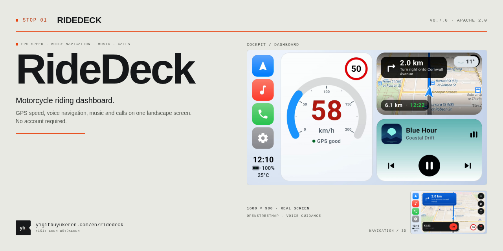
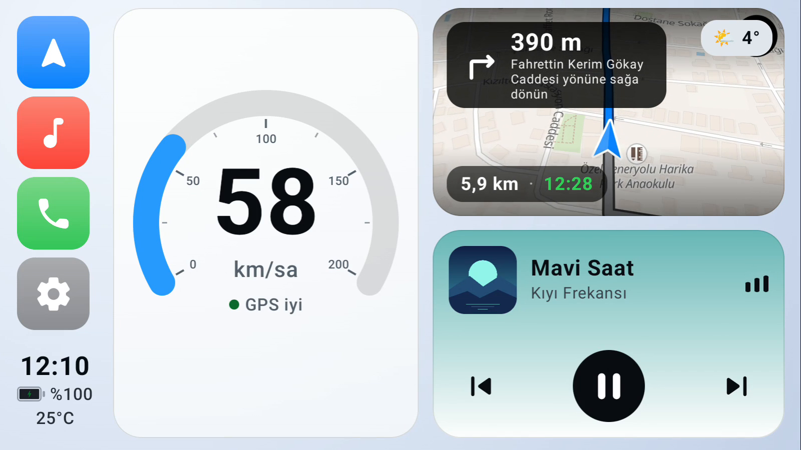
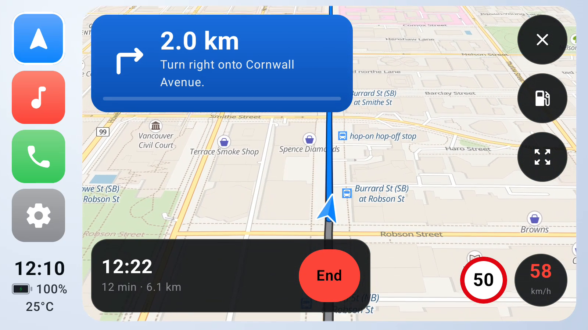
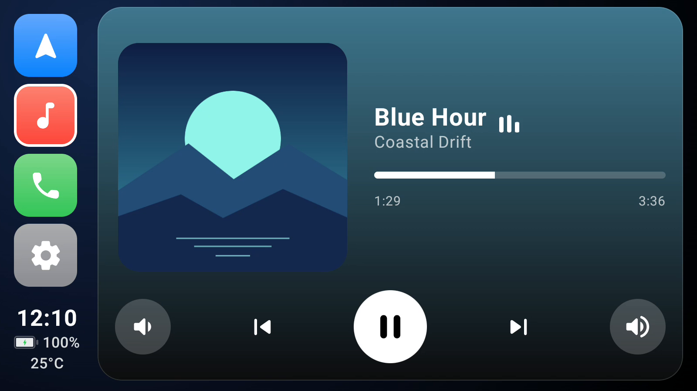

<a href="https://yigitbuyukeren.com/ridedeck/">
  <picture>
    <source media="(prefers-color-scheme: dark)" srcset="docs/screenshots/banner-dark.png">
    
  </picture>
</a>

<div align="center">

# RideDeck

**An open-source motorcycle driving dashboard for your Android phone.**

GPS speedometer · Motorcycle voice navigation · Music · Calls · Local trip history

**[⬇️ Download signed APK (v0.7.0)](https://github.com/yigitbuyukeren/ridedeck/releases/download/v0.7.0/RideDeck-0.7.0.apk)** &nbsp;·&nbsp;
**[🎬 English Launch Video](docs/media/ridedeck-launch-16x9.mp4)** &nbsp;·&nbsp;
**[📋 Release Notes](https://github.com/yigitbuyukeren/ridedeck/releases/tag/v0.7.0)** &nbsp;·&nbsp;
**[🌐 Website](https://yigitbuyukeren.com/en/ridedeck/)**

[](https://github.com/yigitbuyukeren/ridedeck/releases/tag/v0.7.0)
[](https://github.com/yigitbuyukeren/ridedeck/actions/workflows/ci.yml)
[](LICENSE)


🇬🇧 [English](#en) &nbsp;·&nbsp; 🇹🇷 [Türkçe](#tr) &nbsp;·&nbsp; [Demo Video](#demo-video) &nbsp;·&nbsp; [Screenshots](#v070-screenshots) &nbsp;·&nbsp; [Privacy](#privacy) &nbsp;·&nbsp; [Architecture](#architecture) &nbsp;·&nbsp; [Contribute](CONTRIBUTING.md)

</div>

> [!IMPORTANT]
> **RideDeck v0.7.0 is a stable release, but public 1.0 remains NO-GO.** Crash detection/SOS is experimental and has not been field-tested; real-device use, SMS delivery, lock-screen, and OEM behavior remain unverified. RideDeck is not a substitute for emergency services or safety equipment. See [Release readiness](docs/RELEASE_READINESS.md).

<a id="demo-video"></a>

<div align="center">

<a href="docs/media/ridedeck-launch-16x9.mp4">
  
</a>

**▶ [Watch the full 60 fps English launch film with audio (MP4, 3.9 MB)](docs/media/ridedeck-launch-16x9.mp4)**

<sub>The launch film is rendered from v0.7.0 Android emulator debug-build captures (shown in English) with simulated GPS and demo media; the screenshots below are direct 1600×900 emulator captures. Neither represents real-device or on-road validation.</sub>

</div>

---

<a id="en"></a>

## 🇬🇧 English

### Overview

RideDeck turns an Android phone into a landscape, glove-friendly motorcycle cockpit. It brings GPS speed, motorcycle voice navigation, media playback, phone calls, and local trip recording together on a single screen—running directly on your phone with **no RideDeck account, no API keys, and no RideDeck backend**. Online features (maps, search, routing, fuel stations, weather, and speed limits) talk directly to public keyless third-party services.

The interface takes inspiration from Apple CarPlay and Android Auto, but RideDeck is a **standalone Android app**—not a CarPlay or Android Auto integration. Today it is built exclusively for **motorcycles** (there is no vehicle selector; other vehicle types are a possible future direction, not a supported feature).

<a id="v070-screenshots"></a>

### Screenshots

<p align="center">
  <picture>
    <source media="(prefers-color-scheme: dark)" srcset="docs/screenshots/v0.7.0/dashboard-dark.png">
    
  </picture>
</p>

| Route preview | Turn-by-turn navigation | Music |
|:---:|:---:|:---:|
|  |  |  |

<sub>Edge-to-edge 1600×900 English UI captures from an Android emulator debug build (v0.7.0) with simulated GPS and demo media. Not real-device or on-road validation.</sub>

### Features

#### Cockpit & Landscape UI
- **Handlebar-ready layout:** Locked to `sensorLandscape` with per-side display cutout insets so rotating the phone 180° keeps controls clear of the camera cutout while using full screen width.
- **Honest GPS speedometer:** 0–200 km/h motorcycle gauge (`km/h` or `mph`) that smooths GPS jitter for display and falls back to `--` ("GPS signal lost") instead of showing a fabricated `0`. Safety, trip recording, and speed-limit logic read raw GPS speed directly.
- **Glove-friendly & high contrast:** Large touch targets (64–84 dp design rule for primary controls), automatic day/night theme driven by ambient light, clock, battery, phone temperature, and an optional speed/clock overlay strip over other apps.
- **Motion lock while riding:** At ≥ 5 km/h (`MotionTracker`), text search, phone keypad, Settings, and external-app handoff lock automatically; an in-app keyboard is available only while parked.
- **Thermal protection & weather:** Above 42 °C, screen brightness dims, map frame rate scales down, transitions disable, and the screen dims while stopped. Weather shows temperature plus 1-hour rain and icing warnings (30-minute freshness limit).
- **Live language switching:** English (default) and Turkish; switchable from Android 13+ per-app language settings without restarting the app—updating UI text, route instructions, and TTS voice on the fly. Unsupported device locales fall back to English.
- **Streamlined Settings:** Six focused sections (General, Appearance, Map, Sound & Notifications, Safety, Permissions & System) plus a ride-readiness check panel.

#### Motorcycle Navigation & Voice Guidance
- **Embedded vector map:** MapLibre Native rendering OpenStreetMap / OpenFreeMap tiles at up to native refresh rate (90/120 Hz unless thermal protection is active), paired with a live mini-map on the dashboard showing the next turn, remaining distance, and speed-adjusted ETA.
- **Valhalla motorcycle routing:** Always uses Valhalla's `motorcycle` costing with remembered **avoid highways** and **avoid tolls** toggles, heading-aware route starts, and automatic off-route recalculation. **Routing and search require internet.**
- **Three-tier voice guidance:** Advance distance cue, full maneuver instruction, and concise "now" prompt at the turn, plus long-stretch reminders. Pauses TTS during phone calls (using vibration instead) and queues weather/message announcements behind turn prompts.
- **Search, saved places & fuel stops:** Explicit Nominatim search with typo tolerance and "Did you mean?" suggestions (never search-as-you-type); Home, Work, and favorites with one-tap "Go Home" on the dashboard; nearby or along-route fuel stations with one-tap waypoint insertion and parked-only approximate (`≈`) detour estimates.
- **Speed limits & external handoff:** Displays road speed limits with audible overspeed alerts (discarding readings older than 60 s). When parked, any planned route can also be opened in Google Maps, Waze, or Yandex Navi via deep links.
- **Safe process-death recovery:** Saved route geometry restores as preview-only after process death; Start unlocks only when fresh, accurate GPS is within the first 50 m of the route, otherwise prompting an explicit route refresh (no offline routing).

#### Media, Calls & Message Readout
- **Music controls:** Connects to compatible media sessions (requires notification access) with album art, progress bar, swipe-to-skip, volume controls, and Play resuming recent media; halts auto-resume if a headset or helmet intercom disconnects.
- **In-app phone & optional dialer:** Recents, full contacts, and parked-only keypad (contact matching, DTMF tones, long-press `0` for `+`). When set as Android's default dialer (`InCallService`), RideDeck also provides an in-app call screen with mute, system-reported audio routes (handset, speaker, Bluetooth), volume, and in-call keypad.
- **Optional message readout:** Reads incoming messages aloud only while RideDeck is on screen, with per-app mute controls and lock-screen privacy filtering (private notification content is not read on the lock screen).

#### Local Trip History
- **Automatic & explicit recording:** Automatically starts after 3 consecutive GPS fixes ≥ 8 km/h, ends after 3 minutes of inactivity, and drops short trips under 300 m or 60 s. Trips can also be started and stopped explicitly from Trip History—running via a foreground location service even with the screen locked, and stoppable from the notification.
- **On-device SQLite log:** Stores trips locally in `trips.db` with total and moving duration, delete confirmation, and on-demand map trace inspection (up to 2,000 sampled points without bridging GPS gaps).

#### Experimental Crash Detection & SOS
> [!WARNING]
> **Off by default and NOT field-tested.** Crash detection thresholds, real SMS/SIM delivery, lock-screen wake/FSI behavior, and OEM power management have **not** been validated on physical hardware or on the road. Do not rely on SOS as an emergency service or safety guarantee.

- **Triggers:** Accelerometer + GPS impact-and-inactivity detection (with motorcycle tilt/high-G filtering to reduce pothole and red-light false positives; unknown GPS speed is never treated as stopped) or a manual long-press button. Active only while RideDeck is visible or an explicitly started trip foreground service is running.
- **Countdown & SMS attempt:** Attempts to surface over the lock screen via high-priority notification, full-screen intent, and wake lock with **I'm OK** / **Dismiss** actions. After the countdown, attempts a single SMS with a location link to up to 3 user-selected contacts—no automatic voice calls or retries. Results are reported per recipient (confirmed, failed, or uncertain); delivery is not guaranteed and carrier SMS rates may apply.

<a id="privacy"></a>

### Privacy, Permissions & Online Services

**What stays on your phone:** RideDeck has **no account system, no analytics, and no RideDeck servers**. Trip history (`trips.db`), preferences, saved/recent places (`SharedPreferences`), and cached route previews (`noBackupFilesDir`) stay strictly on-device with Android cloud backup disabled (`android:allowBackup="false"` and `dataExtractionRules`). Permissions are requested per feature, and SOS contacts use Android's contact picker without requiring full contacts permission.

**What goes to public third-party services:** Online features contact free, keyless public providers directly from your device (each provider also sees your IP address and the `RideDeck/<version>` `User-Agent`):

| Service | Purpose | Data sent | Notes |
|---|---|---|---|
| **[OpenFreeMap](https://openfreemap.org)** (via MapLibre Native) | Vector map styles & tiles | Visible map viewport area | Uses MapLibre's internal HTTP stack; subject to [OpenFreeMap ToS](https://openfreemap.org/tos/) |
| **[Nominatim](https://nominatim.org)** | Address/place search & reverse geocoding | Search text (only when pressing Search) or lookup coordinates | Max 1 req/s; no search-as-you-type |
| **[Valhalla](https://github.com/valhalla/valhalla)** (`valhalla1.openstreetmap.de` / FOSSGIS) | Motorcycle routing & `trace_attributes` speed limits | Route endpoints/waypoints and recent GPS points | Sends `X-Client-Id` header; keyless public server |
| **[Open-Meteo](https://open-meteo.com)** | Temperature, 1-hour rain & icing warnings | Approximate location (~1 km precision) | Free non-commercial tier, keyless |
| **[Overpass API](https://overpass-api.de)** (FOSSGIS) + Nominatim fallback | Nearby & along-route fuel stations | Search area or route corridor | Queries up to 2 distinct operators in parallel; uses first valid response |

*System TTS note:* RideDeck prefers an offline system voice when available; if you select a cloud-based voice in Android's TTS settings, spoken text may be processed by that TTS provider.

Public third-party services carry no SLA or availability guarantee; in-app throttling and caching do not prove aggregate quota compliance across all users. See [detailed privacy notes (Turkish)](docs/FEATURES-REFERENCE.md#-gizlilik-ve-izinler) and [NOTICE](NOTICE).

### Download & Upgrade

**[⬇️ Download signed stable APK — v0.7.0](https://github.com/yigitbuyukeren/ridedeck/releases/download/v0.7.0/RideDeck-0.7.0.apk)** · [Release notes](https://github.com/yigitbuyukeren/ridedeck/releases/tag/v0.7.0) · [All releases](https://github.com/yigitbuyukeren/ridedeck/releases)

- **Requirements:** Android **8.0+ (API 26)**, ARM device (release APK is ARM-only, v2 signed).
- **Upgrading from `0.6.x`:** Installs in place over existing `0.6.x` builds using the same signing key.
- **Upgrading from `0.5.0`:** Uses a newer signing key introduced on 2026-11-08; uninstalling `0.5.0` first may be required, which can erase its local app data.
- **Verification checksums (`RideDeck-0.7.0.apk`, `versionCode 8`):**
  - APK SHA-256: `08e264b2c6a1235418aa89ed4646074dca71677a4ca01e5ea031811d084b845d`
  - Signing cert SHA-256: `9d9164ef8c679f2909e2a851d1327839c684cad238ca0932488a9f8d0f622427`

### Verification & Release Readiness

| Check | Reported result (v0.7.0 — 2026-11-18) |
|---|---|
| **Release artifact** | `0.7.0` (`versionCode 8`), ARM-only, v2-signed APK |
| **JVM unit tests** | **848/848 debug + 848/848 release** (**1,696 total**, 0 failures, 0 skipped) |
| **Android instrumentation** *(x86_64 API 35 emulator)* | **208 passed + 1 skipped** in combined run; skipped permission test passed separately (**1/1**, 209 verified) |
| **Lint & 16 KB alignment** | **0 lint errors** (debug 105 / release 104 warnings); static 16 KB ELF LOAD and `zipalign -c -P 16 4` passed |
| **Runtime language switch** | `en-US` → `tr-TR` verified on emulator without process restart; 470 matched string/plural keys |
| **Offline map downloads** | Existing downloaded areas retained; **new downloads & resumes paused (`BLOCKED`)** pending provider-compliance verification; no offline routing |
| **Real-device / field validation** | **UNVERIFIED — public 1.0 is NO-GO** (physical hardware, on-road GPS, real SMS/SIM/calls, intercom, lock-screen/Doze/OEM, thermal/battery, audible TTS, 16 KB runtime) |

Read more: [Release readiness](docs/RELEASE_READINESS.md) · [Project status](docs/STATUS.md) · [Technical case study](docs/CASE-STUDY.en.md) · [Detailed feature reference (Turkish)](docs/FEATURES-REFERENCE.md)

<a id="architecture"></a>

### Architecture, Tech Stack & Build

RideDeck is a **single-module (`:app`), single-`Activity` Kotlin + Jetpack Compose** Android app (`minSdk 26`, `compileSdk`/`targetSdk 36`, **JDK 17**). It uses MapLibre Native, OkHttp, SQLite, and Android's raw `LocationManager` with **no Play Services, no DI framework, and no Navigation library**. Core domain logic (speed filtering, route snapping, motion lock, crash math, provider throttling) is kept Android-free for fast JVM unit testing.

| Package | Responsibility | Key files |
|---|---|---|
| `com.ridedeck.app` | Entry points, process owners & screen wiring | `MainActivity.kt`, `RideDeckApplication.kt`, `DashboardViewModel.kt` |
| `data/` | Pure logic, repositories, `LocationArbiter`, `NavigationController`, `RideSafety`, `Http`/`ProviderHttp`, SQLite persistence | `LocationRepository.kt`, `NavigationController.kt`, `RideSafety.kt`, `Http.kt`, `TripStore.kt` |
| `ui/` | Jetpack Compose screens, cards, theme & map view | `DashboardScreen.kt`, `MapScreen.kt`, `SettingsScreen.kt`, `TripsScreen.kt`, `PhoneScreen.kt`, `SosUi.kt` |
| `service/` | Foreground tracking service, overlay strip, notification listener & dialer bridges | `RideTrackingService.kt`, `OverlayService.kt`, `CarNotificationListener.kt`, `MotoInCallService.kt`, `SosActionReceiver.kt` |
| `util/` | Preferences, unit formatting, external launches & text helpers | `Prefs.kt`, `Units.kt`, `Launch.kt`, `MessageText.kt` |

#### Build locally

Requires **JDK 17** and **Android SDK 36**. Point `local.properties` to your SDK (`sdk.dir=/path/to/Android/sdk`), then run:

```bash
# Quick build & debug unit tests
./gradlew testDebugUnitTest assembleDebug

# Fast PR gate (debug unit tests, debug lint, debug APK)
./gradlew testDebugUnitTest lintDebug assembleDebug
```

#### Documentation & Community

| Getting started | Reference & policies |
|---|---|
| [Contributing Guide](CONTRIBUTING.md) · [Good first issues](https://github.com/yigitbuyukeren/ridedeck/contribute) | [Architecture](docs/ARCHITECTURE.md) · [Development Guide](docs/DEVELOPMENT.md) |
| [Report a bug](https://github.com/yigitbuyukeren/ridedeck/issues/new?template=bug_report.yml) · [Support](SUPPORT.md) | [Technical Case Study](docs/CASE-STUDY.en.md) · [Translating](docs/TRANSLATING.md) |
| [Security Policy](SECURITY.md) *(do not open public issues for vulnerabilities)* | [Code of Conduct](CODE_OF_CONDUCT.md) · [License (Apache 2.0)](LICENSE) · [Third-party Notices](NOTICE) |

> [!WARNING]
> Operating a screen while riding can be distracting. Mount your phone securely, adjust settings only while parked, and obey local traffic laws. Provided without warranty under [Apache 2.0](LICENSE). Map data © [OpenStreetMap contributors](https://www.openstreetmap.org/copyright) (ODbL 1.0); see [NOTICE](NOTICE) for full provider and library attributions.

---

<a id="tr"></a>

## 🇹🇷 Türkçe

### Genel Bakış

RideDeck, Android telefonunu yatay, eldivenle kullanılabilen **açık kaynak bir motosiklet sürüş paneline** dönüştürür. GPS hız göstergesini, sesli motosiklet navigasyonunu, medya ve telefon kontrollerini ve yerel yolculuk geçmişini tek ekranda birleştirir. **RideDeck hesabı, API anahtarı veya RideDeck'e ait bir sunucu yoktur**; çevrimiçi özellikler doğrudan ücretsiz, anahtarsız üçüncü taraf servislerle konuşur.

Arayüz Apple CarPlay ve Android Auto'dan ilham alır, ancak RideDeck doğrudan Android telefonda çalışan **bağımsız bir uygulamadır**; CarPlay veya Android Auto entegrasyonu sunmaz. Bugün yalnızca **motosiklet** için tasarlanmıştır (araç seçici yoktur; başka araç türleri gelecekte değerlendirilebilir ancak şu anda desteklenmez).

> [!IMPORTANT]
> **RideDeck v0.7.0 kararlı sürümdür, ancak kamuya açık 1.0 kararı NO-GO'dur.** Kaza algılama/SOS deneyseldir ve saha testi yapılmamıştır; gerçek cihaz kullanımı, SMS teslimi, kilit ekranı ve üretici (OEM) davranışları doğrulanmamıştır. Acil durum hizmetlerinin veya güvenlik ekipmanının yerine geçmez. Bkz. [Yayın hazırlığı](docs/RELEASE_READINESS.md).

### Lansman Videosu ve Ekran Görüntüleri

- **🎬 Lansman önizlemesi ve tam film:** Yukarıdaki [Demo Video](#demo-video) bölümündeki animasyonlu önizlemeyi izleyebilir veya **[İngilizce sesli tam 60 fps lansman filmini (MP4, 3,9 MB)](docs/media/ridedeck-launch-16x9.mp4)** doğrudan açabilirsin.
- **📸 v0.7.0 ekran görüntüleri:** Yukarıdaki [Ekran Görüntüleri](#v070-screenshots) galerisinde gündüz/gece ana panel, rota önizlemesi, adım adım navigasyon ve müzik ekranları yer alır.

<sub>Uluslararası depo için hazırlanan lansman filmi, Android emülatöründeki v0.7.0 debug derlemesinden alınan İngilizce arayüz kayıtları, simüle edilmiş GPS ve demo müzikle kurgulanmıştır; ekran görüntüleri doğrudan 1600×900 emülatör kaydıdır. Gerçek cihaz veya sürüş doğrulaması değildir.</sub>

### Kapsamlı Özellikler

#### Kokpit ve Yatay Arayüz
- **Gidona uygun yatay düzen:** `sensorLandscape` kilidi ve kamera çentiğine özel kenar boşlukları sayesinde telefon 180° çevrildiğinde de kontroller çentikten korunur ve ekran genişliği tam kullanılır.
- **Gerçekçi GPS hız göstergesi:** 0–200 km/sa motosiklet kadranı (`km/sa` veya `mil/sa`) gösterimde GPS gürültüsünü yumuşatır; sinyal kesilince sahte `0` yerine `--` ve "GPS sinyali kayıp" gösterir. Kaza algılama, yolculuk kaydı ve hız limiti uyarıları ham GPS hızını kullanır.
- **Eldivenle kullanım ve yüksek kontrast:** Büyük dokunma hedefleri (birincil eylemlerde 64–84 dp tasarım kuralı), ortam ışığına göre otomatik gündüz/gece teması, saat, pil, telefon sıcaklığı ve diğer uygulamaların üstünde hız/saat şeridi.
- **Sürüşte hareket kilidi:** `5 km/sa` ve üzerinde (`MotionTracker`) metin araması, tuş takımı, Ayarlar ve dış navigasyon geçişi otomatik kilitlenir; uygulamanın kendi Türkçe klavyesi yalnızca park halindeyken açılır.
- **Isınma koruması ve hava durumu:** Telefon 42 °C'yi aşınca parlaklık kısılır, harita çizimi yavaşlar, geçiş animasyonları kapanır ve dururken ekran kararır. Hava durumu; sıcaklık, 1 saat içinde yağmur ve buzlanma uyarısı sunar (30 dakikalık tazelik sınırı).
- **Canlı uygulama dili geçişi:** İngilizce (varsayılan) ve Türkçe desteklenir; Android 13+ uygulama dili menüsünden seçildiğinde uygulama yeniden başlamadan arayüz, rota metinleri ve TTS sesi yeni dile geçer. Desteklenmeyen cihaz dilleri İngilizceye düşer.
- **Düzenli Ayarlar:** Altı bölüm (Genel, Görünüm, Harita, Ses ve bildirimler, Güvenlik, İzinler ve sistem) ve **Sürüşe hazır mı?** kontrol paneli.

#### Motosiklet Navigasyonu ve Sesli Yönlendirme
- **Gömülü vektör harita:** MapLibre Native + OpenStreetMap / OpenFreeMap karoları (ısınma koruması kapalıyken 90/120 Hz ekran yenileme hızında) ve ana ekranda sıradaki dönüşü, kalan mesafeyi ve gerçek hıza uyarlanan varış saatini gösteren canlı mini harita.
- **Valhalla motosiklet rotası:** Her zaman Valhalla `motorcycle` profiliyle hesaplanır; **otoyolsuz** ve **ücretsiz yol** tercihlerini hatırlar, sürüş yönüne uygun başlar ve rota dışına çıkınca yeniden hesaplar. **Rota ve arama için internet gerekir.**
- **Üç kademeli sesli yönlendirme:** Uzak uyarı, tam dönüş talimatı ve dönüş anında kısa "şimdi" anonsu ile uzun yol hatırlatmaları. Telefon görüşmesinde TTS susar (titreşim kullanılır); mesaj ve hava uyarıları dönüş talimatını kesmeden sırayla okunur.
- **Arama, kayıtlı yerler ve benzinlikler:** Yazım hatası toleranslı ve "Bunu mu demek istedin?" önerili Nominatim araması (yalnızca Ara'ya basınca sorgular); Ev, İş ve favoriler (ana ekrandan tek dokunuşla "Eve git"); yakınında veya rota üzerindeki benzinlikler için tek dokunuşla ara durak ekleme ve dururken yaklaşık (`≈`) sapma süresi/mesafesi hesabı.
- **Hız limitleri ve dış uygulama geçişi:** Yolun hız limitini gösterir ve aşınca sesli uyarır (60 sn'den eski veriler gösterilmez). Dururken hesaplanan hedef Google Haritalar, Waze veya Yandex Navi'de açılabilir.
- **Süreç ölümü sonrası güvenli toparlanma:** Kalan rota geometrisi yalnızca önizleme olarak geri gelir; **Başlat** yalnız taze ve hassas GPS ilk 50 m içindeyse açılır, aksi hâlde açıkça **Rotayı güncelle** istenir (çevrimdışı rota hesabı yoktur).

#### Medya, Telefon ve Mesaj Seslendirme
- **Müzik kontrolleri:** Uyumlu medya oturumlarına bağlanır (bildirim erişimi gerekir); albüm kapağı, ilerleme çubuğu, kapağı kaydırarak parça geçme, ses tuşları ve son müziği başlatma sunar; kask/kulaklık bağlantısı koparsa otomatik devamı durdurur.
- **Uygulama içi telefon ve isteğe bağlı arama ekranı:** Son aramalar, tüm rehber ve dururken açılan tuş takımı (eşleşen kişi önerisi, DTMF sesi, `0` uzun basınca `+`). RideDeck varsayılan telefon uygulaması (`InCallService`) yapılırsa sessiz, sistemin bildirdiği ses yolları (telefon, hoparlör, Bluetooth), ses seviyesi ve görüşme tuş takımı uygulama içinde sunulur.
- **İsteğe bağlı mesaj seslendirme:** Yalnızca RideDeck ekrandayken çalışır; uygulama bazlı sessize alma ve kilit ekranı gizlilik koruması içerir (kilit ekranında gizli bildirim içeriği okunmaz).

#### Yerel Yolculuk Geçmişi
- **Otomatik ve elle kayıt:** Art arda 3 GPS ölçümü ≥ 8 km/sa olduğunda otomatik başlar, 3 dk hareketsizlikte biter; 300 m veya 60 sn altındaki kısa kayıtları eler. Geçmiş ekranından açıkça başlatılan takip, ekran kilitliyken de ön plan konum servisiyle sürer ve bildirimden bitirilebilir.
- **Cihaz içi SQLite kaydı:** Yolculuklar `trips.db` içinde yerel tutulur; toplam ve hareket süresi ayrı gösterilir, silme onay ister ve harita izi talep üzerine çizilir (en çok 2.000 örneklenmiş nokta, GPS boşlukları yapay çizgiyle birleştirilmez).

#### Deneysel Kaza Algılama ve SOS
> [!WARNING]
> **Varsayılan olarak kapalıdır ve sahada test EDİLMEMİŞTİR.** Kaza algılama eşikleri, gerçek SMS/SIM teslimi, kilit ekranı uyandırma/FSI ve üretici (OEM) güç yönetimi gerçek cihazda veya yolda doğrulanmamıştır. SOS bir acil durum hizmeti ya da güvenlik garantisi değildir.

- **Tetikleme:** İvmeölçer + GPS ile sert darbe ve hareketsizlik algılama (çukur/kırmızı ışık yanlış alarmlarını azaltan motosiklet eğim/yüksek darbe filtreleri; bilinmeyen GPS hızı duruş sayılmaz) veya uzun basmalı manuel düğme. Yalnızca RideDeck ekrandayken veya başlatılmış bir yolculuk ön plan servisi sürerken aktiftir.
- **Geri sayım ve SMS denemesi:** Ekran kapalıyken yüksek öncelikli bildirim, tam ekran bildirim (FSI) ve uyandırma kilidiyle öne çıkmaya çalışır; bildirimde **İyiyim** / **Kapat** eylemleri bulunur. Geri sayım sonunda seçilen en fazla 3 kişiye konum bağlantılı tek SMS gönderimi denenir (otomatik arama veya tekrar gönderim yoktur). Sonuçlar kişi bazında (onaylanan, başarısız, belirsiz) gösterilir; teslimat garanti edilmez ve operatör SMS ücreti uygulanabilir.

### Gizlilik, İzinler ve Üçüncü Taraf Servisler

**Cihazda kalan veriler:** RideDeck'te **hesap, analitik veya RideDeck sunucusu yoktur**. Yolculuk geçmişi (`trips.db`), ayarlar, kayıtlı/son yerler (`SharedPreferences`) ve yerel rota önizlemesi (`noBackupFilesDir`) yalnızca telefonda tutulur; Android bulut yedeklemesi kapalıdır (`android:allowBackup="false"` ve `dataExtractionRules`). İzinler kullanılan özelliğe göre istenir; SOS kişileri telefonun kişi seçicisiyle eklenir (rehber izni gerekmez).

**Dış servislere giden veriler:** Çevrimiçi özellikler cihazdan doğrudan ücretsiz, anahtarsız genel servislere bağlanır (bu servisler istekle birlikte IP adresini ve `RideDeck/<sürüm>` `User-Agent` bilgisini görebilir):

| Servis | Kullanım | Gönderilen veri | Not |
|---|---|---|---|
| **[OpenFreeMap](https://openfreemap.org)** *(MapLibre Native üzerinden)* | Vektör harita stilleri ve karoları | Görünen harita bölgesi | MapLibre'nin kendi HTTP motorunu kullanır; [OpenFreeMap koşullarına](https://openfreemap.org/tos/) tabidir |
| **[Nominatim](https://nominatim.org)** | Adres/yer arama ve ters geocode | Arama metni (yalnızca Ara'ya basınca) veya koordinat | En çok 1 istek/sn; yazarken arama yapmaz |
| **[Valhalla](https://github.com/valhalla/valhalla)** (`valhalla1.openstreetmap.de` / FOSSGIS) | Motosiklet rotası ve `trace_attributes` hız limitleri | Rota uç/ara noktaları ve son GPS noktaları | `X-Client-Id` başlığı gönderir; anahtarsız genel sunucu |
| **[Open-Meteo](https://open-meteo.com)** | Sıcaklık, 1 saatlik yağmur ve buzlanma uyarısı | Yaklaşık konum (~1 km hassasiyet) | Ücretsiz ticari olmayan kullanım, anahtarsız |
| **[Overpass API](https://overpass-api.de)** (FOSSGIS) + Nominatim yedeği | Yakındaki ve rota üzerindeki benzinlikler | Arama alanı veya rota koridoru | En çok 2 farklı operatöre paralel sorar; ilk geçerli yanıtı kullanır |

*Sistem TTS notu:* Çevrimdışı sistem sesi varsa öncelikle o tercih edilir; Android TTS ayarlarında ağ gerektiren bir ses seçilirse okunan metin o TTS sağlayıcısında işlenebilir.

Bu servisler garantisiz genel hizmetlerdir; uygulama içi hız sınırlama ve önbellekleme sağlayıcıların tüm kullanıcılar toplamındaki kotasını kanıtlamaz. Ayrıntılar için [Gizlilik ve izinler](docs/FEATURES-REFERENCE.md#-gizlilik-ve-izinler) ve [NOTICE](NOTICE) dosyalarına bak.

### İndir ve Kur

**[⬇️ Resmî imzalı kararlı APK: v0.7.0](https://github.com/yigitbuyukeren/ridedeck/releases/download/v0.7.0/RideDeck-0.7.0.apk)** · [Sürüm notları](https://github.com/yigitbuyukeren/ridedeck/releases/tag/v0.7.0) · [Tüm sürümler](https://github.com/yigitbuyukeren/ridedeck/releases) · [Web sitesi](https://yigitbuyukeren.com/ridedeck/)

- **Gereksinim:** Android **8.0+ (API 26)**, ARM cihaz (release APK yalnız ARM'dır, v2 imzalıdır).
- **`0.6.x` üzerinden yükseltme:** Aynı imza anahtarıyla verileri koruyarak doğrudan güncellenir.
- **`0.5.0` üzerinden yükseltme:** 8 Kasım 2026'da imza anahtarı yenilendiğinden önce eski sürümü kaldırmak gerekebilir; bu işlem yerel uygulama verilerini silebilir.
- **Doğrulama özetleri (`RideDeck-0.7.0.apk`, `versionCode 8`):**
  - APK SHA-256: `08e264b2c6a1235418aa89ed4646074dca71677a4ca01e5ea031811d084b845d`
  - İmza sertifikası SHA-256: `9d9164ef8c679f2909e2a851d1327839c684cad238ca0932488a9f8d0f622427`

### Güncel Doğrulama ve Sınırlar

| Kontrol | Son raporlanan sonuç (v0.7.0 — 18 Kasım 2026) |
|---|---|
| **Kararlı sürüm** | `0.7.0` (`versionCode 8`), yalnız ARM, v2 imzalı APK |
| **JVM birim testleri** | **848/848 debug + 848/848 release** (**1.696 toplam**, 0 hata, 0 atlama) |
| **Android instrumentation** *(x86_64 API 35 emülatör)* | **208 geçti + 1 atlandı**; atlanan izin testi ayrı koşuda geçti (**1/1**, 209 doğrulandı) |
| **Lint ve 16 KB hizalama** | **0 lint hatası** (debug 105 / release 104 uyarı); 16 KB statik ELF LOAD ve `zipalign -c -P 16 4` geçti |
| **Çalışma zamanı dil geçişi** | `en-US` → `tr-TR` geçişi emülatörde süreç yeniden başlamadan doğrulandı; 470 eşleşen string/plural anahtarı |
| **Çevrimdışı harita indirme** | Önceden indirilmiş bölgeler korunur; **yeni indirme ve devam duraklatıldı (`BLOCKED`)**; çevrimdışı rota/arama yok |
| **Gerçek cihaz / saha doğrulaması** | **DOĞRULANMADI — kamuya açık 1.0 kararı NO-GO** (fiziksel cihaz, gerçek sürüş/GPS, gerçek SMS/SIM/arama, interkom, kilit ekranı/Doze/OEM, pil/ısı, kulakla TTS, 16 KB runtime) |

Ayrıntılar: [Yayın hazırlığı](docs/RELEASE_READINESS.md) · [Proje durumu](docs/STATUS.md) · [Teknik vaka analizi](docs/CASE-STUDY.md) · [Ayrıntılı özellik referansı](docs/FEATURES-REFERENCE.md)

### Mimari, Geliştirme ve Katkı

RideDeck; **tek modüllü (`:app`), tek `Activity`'li Kotlin + Jetpack Compose** Android uygulamasıdır (`minSdk 26`, `compileSdk`/`targetSdk 36`, **JDK 17**). MapLibre Native, OkHttp, SQLite ve ham `LocationManager` kullanır; Play Services, DI framework'ü ve navigasyon kütüphanesi içermez. Çekirdek mantık (hız filtresi, rota eşleme, hareket kilidi, kaza matematiği, sağlayıcı sınırları) Android bağımlılığı olmadan JVM birim testleriyle doğrulanır.

| Paket | Sorumluluk | Öne çıkan dosyalar |
|---|---|---|
| `com.ridedeck.app` | Giriş noktaları, süreç sahipleri ve ekran bağlama | `MainActivity.kt`, `RideDeckApplication.kt`, `DashboardViewModel.kt` |
| `data/` | Saf mantık, repository'ler, `LocationArbiter`, `NavigationController`, `RideSafety`, `Http`/`ProviderHttp`, SQLite | `LocationRepository.kt`, `NavigationController.kt`, `RideSafety.kt`, `Http.kt`, `TripStore.kt` |
| `ui/` | Jetpack Compose ekranları, kartlar, tema ve harita | `DashboardScreen.kt`, `MapScreen.kt`, `SettingsScreen.kt`, `TripsScreen.kt`, `PhoneScreen.kt`, `SosUi.kt` |
| `service/` | Ön plan servisi, hız/saat şeridi, bildirim ve arama köprüleri | `RideTrackingService.kt`, `OverlayService.kt`, `CarNotificationListener.kt`, `MotoInCallService.kt`, `SosActionReceiver.kt` |
| `util/` | Tercihler, birim dönüşümü, dış uygulama ve metin yardımcıları | `Prefs.kt`, `Units.kt`, `Launch.kt`, `MessageText.kt` |

```bash
# Android SDK 36 ve JDK 17 hazır olmalı; local.properties içine sdk.dir ayarla
./gradlew testDebugUnitTest assembleDebug

# Hızlı PR kapısı (debug birim testleri, debug lint, debug APK)
./gradlew testDebugUnitTest lintDebug assembleDebug
```

| Başlamak için | Belge ve politikalar |
|---|---|
| [Katkı rehberi](CONTRIBUTING.md) · [İlk katkıya uygun işler](https://github.com/yigitbuyukeren/ridedeck/contribute) | [Mimari](docs/ARCHITECTURE.md) · [Geliştirme ortamı ve testler](docs/DEVELOPMENT.md) |
| [Hata bildir](https://github.com/yigitbuyukeren/ridedeck/issues/new?template=bug_report.yml) · [Destek](SUPPORT.md) | [Teknik vaka analizi](docs/CASE-STUDY.md) · [Çeviri katkısı](docs/TRANSLATING.md) |
| [Güvenlik bildirimi](SECURITY.md) *(açıkları herkese açık issue yerine buradan bildir)* | [Davranış kuralları](CODE_OF_CONDUCT.md) · [Lisans (Apache 2.0)](LICENSE) · [Üçüncü taraf bildirimleri](NOTICE) |

> [!WARNING]
> Bu uygulama sürüş sırasında dikkat dağıtabilir. Telefonu sağlam biçimde sabitle, ayarları yalnız park halindeyken yap ve trafik kurallarına uy. Yazılım [Apache 2.0](LICENSE) lisansıyla garantisiz sunulur. Harita verisi © [OpenStreetMap katkıda bulunanları](https://www.openstreetmap.org/copyright) (ODbL 1.0); tüm sağlayıcı ve kütüphane atıfları [NOTICE](NOTICE) içindedir.
