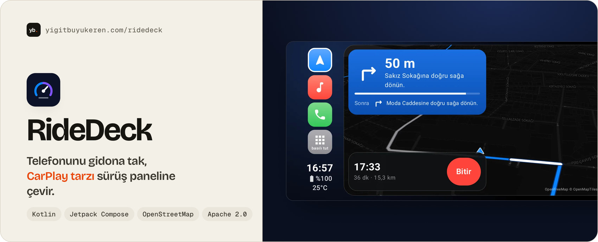
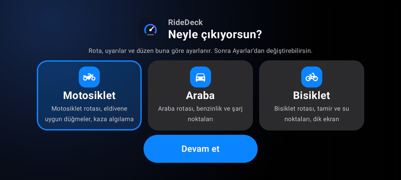
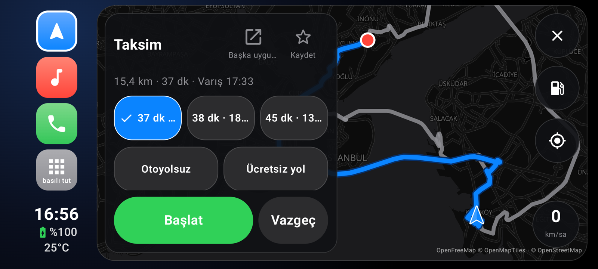
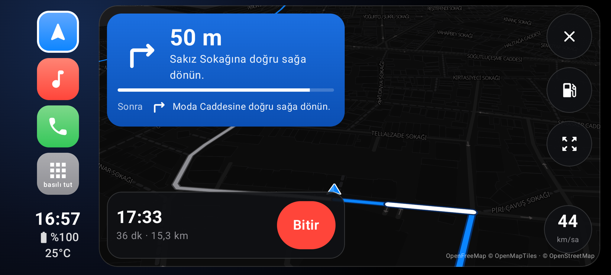
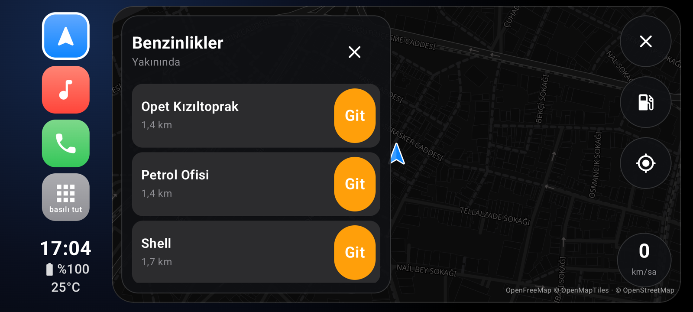
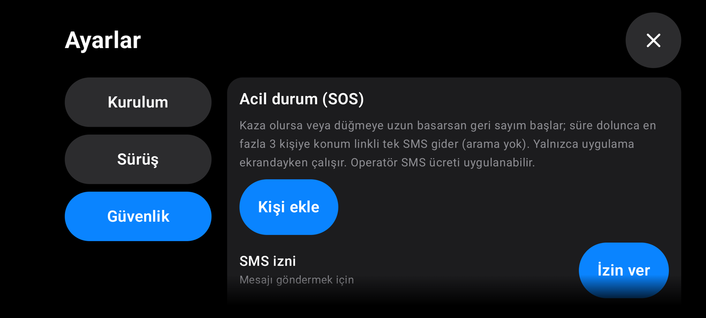

<a href="https://yigitbuyukeren.com/ridedeck/">
  <picture>
    <source media="(prefers-color-scheme: dark)" srcset="docs/screenshots/banner-dark.jpg">
    
  </picture>
</a>

<div align="center">

**[⬇️ APK indir](https://github.com/yigitbuyukeren/ridedeck/releases/latest)** &nbsp;·&nbsp; **[🌐 Proje sayfası](https://yigitbuyukeren.com/ridedeck/)** &nbsp;·&nbsp; **[📖 Teknik vaka analizi](docs/CASE-STUDY.md)** &nbsp;·&nbsp; **[🧭 Özellikler](#-özellikler)** &nbsp;·&nbsp; **[🛠️ Derleme](#️-derleme)** &nbsp;·&nbsp; **[🤝 Katkı](CONTRIBUTING.md)**

[](https://github.com/yigitbuyukeren/ridedeck/releases/latest)
[](https://github.com/yigitbuyukeren/ridedeck/actions/workflows/ci.yml)
[](LICENSE)


🇹🇷 [Türkçe](#-türkçe) &nbsp;·&nbsp; 🇬🇧 [English](#-english)

</div>

<p align="center"><br><sub>Emülatörde, sahte GPS ile alınmış ekran görüntülerinin geçişi; ekran kaydı veya gerçek cihaz testi değildir. GIF, araç seçiminin kaldırılmasından önce çekilmiştir.</sub></p>

<details open>
<summary><h2>🇹🇷 Türkçe</h2></summary>

Telefonu gidona veya motosiklet üstüne takınca **hız, harita, müzik ve telefon tek ekranda** toplanır. RideDeck yalnız motosiklet için tasarlanmıştır; rota, uyarılar ve düzen motosiklete göre ayarlanır. Tüm arayüz eldivenle kullanılacak büyüklükte, sürerken yazı girişi yoktur.

### ✨ Öne çıkanlar

| 🧭 **Sesli yönlendirme** | 📞 **Telefon ve müzik** | 🆘 **SOS ve kaza algılama** |
|:---:|:---:|:---:|
| OpenStreetMap haritası, motosiklet rotası, ara durak ve benzinlik | Uygulama içi telefon (son aramalar, rehber, tuş takımı), müzik kontrolü, mesajları sesli okuma | Sert darbe ve hareketsizlikte geri sayım, sonra konum linkli tek SMS |
| 🗺️ **Çevrimdışı harita** | 🌦️ **Uyarılar** | 🔒 **Gizlilik** |
| Ayarlar'dan çevredeki haritayı indir; rota, arama ve hava durumu yine internet ister | Yağmur ve buzlanma uyarısı; telefon ısınınca ekran kısılır | Veriler telefonda kalır; yalnızca harita/yer sorguları çıkar, sesli yönlendirme Android'in metin okuma motoruyla yapılır |

### 📸 Ekran görüntüleri

Aşağıdakiler Android emülatöründen (Türkçe arayüz) alınmıştır.

| Rota |
|---|
|  |

| Navigasyon | Benzinlikler |
|---|---|
|  |  |

| SOS geri sayımı | Güvenlik ayarları |
|---|---|
|  |  |

### 📲 Kurulum

1. [Son sürümün](https://github.com/yigitbuyukeren/ridedeck/releases/latest) APK'sını indir ve kur (bilinmeyen kaynaklardan kuruluma izin ver). 0.5.0 kuruluysa önce kaldır: 0.6.0 yeni bir imza anahtarı kullanır, üstüne güncelleme kurulmaz.
2. İlk açılışta yalnızca konum izni istenir; telefon, müzik ve SOS izinleri ilgili özelliği açarken sorulur.
3. Müzik ve mesaj okuma için Ayarlar > İzinler ve sistem'den bildirim erişimini ver.

### 🧭 Özellikler

Ayrıntılar için başlıklara dokun.

<details>
<summary><b>Motosiklet profili</b></summary>

- Uygulama yalnız motosiklet içindir; araç seçim ekranı ve Ayarlar'daki araç seçimi kaldırıldı
- Rota her zaman Valhalla `motorcycle` costing'i ile hesaplanır; otoyolsuz ve ücretsiz yol seçenekleri hatırlanır
- ⛽ düğmesi benzinlik arar; benzinlik, ara durak ve rota üzerindeki duraklar motosiklet akışında çalışır
- Kaza algılama eşikleri ve 200 km/s hız göstergesi motosiklete sabittir; arayüz yatay gidon düzenindedir

</details>

<details>
<summary><b>Gösterge ve sürüş</b></summary>

- GPS hız göstergesi, saat, pil ve telefon sıcaklığı; gündüz/gece teması (ortam ışığına göre otomatik). Gösterilen hız GPS gürültüsünü yumuşatır ve imkânsız sıçramaları bir kez tutar; sinyal kesilince son değer kısa süre kalır, sonra uydurma 0 yerine `--` ve "GPS sinyali kayıp" görünür. Kaza algılama, yolculuk kaydı ve limit uyarısı ham GPS hızını kullanır
- Yolculuk kaydı: otomatik, geçmiş ekranı; hız kartından açılan geçmişte **Yolculuğu başlat / bitir**. Açıkça başlatılan takip overlay kapalıyken ve ekran kilitliyken de sürer; bildirimden bitirilebilir. Kayıt ayarı ve kısa sürüş eleme kuralları korunur.
- Hız kartında GPS durumu; büyük, eldivenle basılan tuşlar; ekranlar arasında kısa geçiş animasyonları (ısı koruması açıkken kapanır)
- Türkçe ve İngilizce arayüz; sesli yönlendirme telefon diline göre konuşur (Türkçe telefonda Türkçe talimat ve ses, diğerlerinde İngilizce)

</details>

<details>
<summary><b>Navigasyon</b></summary>

- Gömülü harita ve sesli yönlendirme: MapLibre + OpenStreetMap (OpenFreeMap), Nominatim arama, Valhalla motosiklet rotası, rota dışına çıkınca yeniden hesaplama
- Anonslar üç kademe: mesafeli uzak uyarı ("800 metre sonra sağa dön"), tam talimat, dönüşte kısa "şimdi"; uzun yolda "2 km devam". Mesaj ve hava uyarıları dönüş talimatını kesmez, sonra okunur. Rota isteği sürüş yönünü taşır (U dönüşüyle başlamaz). İnternet yokken yeniden hesaplama başarısız olursa bir kez söylenir, eski rota izlenir. Varış: rota sonu, hedefte durma veya kapalı otoparkta GPS kaybıyla; varış saati gerçek hıza uyum sağlar. Görüşmede talimat yerine titreşim, görüşme bitince talimat okunur.
- Rota seçenekleri: otoyolsuz ve ücretsiz yol, seçim hatırlanır
- Kayıtlı yerler: Ev, İş ve favoriler; büyük karolarla tek dokunuşla rota, dashboard'da "Eve git"
- Benzinlikler: yakınında veya rotanın üzerinde; navigasyon sırasında tek dokunuşla **ara durak** ekle, varınca "Yola devam"
- Yolun hız limiti ve aşınca sesli uyarı
- Sürerken arama kutusu ve Ayarlar kilitlenir (sürüş kuralı: hareket halindeyken yazı girişi ve ayar değişikliği yok); hedefi kayıtlı yerlerden veya haritaya uzun basarak seç
- Yazım hatası toleransı: sonuç çıkmazsa düzeltilmiş yazımlar (Türkçe harfler, eksik veya yer değiştirmiş harf) en çok üç kez, saniyede en fazla bir istekle denenir; yine bulunamazsa "Bunu mu demek istedin?" önerisi gelir. Önerilen yer sormadan rotaya girmez. Seçtiğin son hedefler yalnızca telefonda tutulur (Ayarlar > Genel'den kapatılır, "Geçmişi sil" ile silinir)
- Navigasyon sürerken ana ekranda canlı mini harita, sıradaki dönüş, kalan mesafe ve varış saati
- Arama kutusu için uygulamanın kendi Türkçe klavyesi

</details>

<details>
<summary><b>Uygulamalar, kartlar ve ses</b></summary>

- Dock'taki dişli düğmesi Ayarlar'ı açar; sürüş sırasında ayarlar kilitlenir.
- Ayarlar altı bölüme ayrıldı: Genel, Görünüm, Harita, Ses ve bildirimler, Güvenlik, İzinler ve sistem. Üstteki bölüm şeridi yatay kayar; geniş ekranda (yatay telefon) satırlar iki sütuna yayılır, dik ekranda tek sütun kalır.
- Ana ekran kartları ayarlanır (Ayarlar > Görünüm): harita, müzik, uygulama kartı veya boş. Önceden sabitlenmiş uygulamalar kartta kalır; yeni uygulama ekleme kaldırılmıştır.
- Rota kartında "Navigasyon uygulamasında aç" (Google Haritalar, Waze, Yandex Navi derin bağlantıları, yalnızca dururken); rota hâlâ RideDeck'te hesaplanır, canlı trafik isteyen bu uygulamalara geçer
- Mil ve mph ayarı (Ayarlar > Genel): hız, mesafe, hız limiti ve rota sesleri
- Düğmelere basınca hafif dokunma titremesi (Ayarlar > Genel'den kapatılır); telefonun "dokunma geri bildirimi" ayarı kapalıysa yine de titremez
- Mesaj uygulamalarını tek tek sessize alma (Ayarlar > Ses ve bildirimler'deki uygulama listesi)

</details>

<details>
<summary><b>Güvenlik</b></summary>

- Hava durumu: sıcaklık, 1 saat içinde yağmur ve buzlanma uyarısı
- Isınma koruması: telefon 42°C'yi aşınca ekran kısılır ve harita yavaşlar, motosiklet durunca ekran kararır
- SOS (varsayılan kapalı): otomatik kaza algılama (sert darbe + hareketsizlik; iki tekerlekte yön değişimi veya çok yüksek darbe aranır) veya uzun basmalı düğme. Çukur/kırmızı ışık kaynaklı yanlış alarmları azaltan filtreler var; bilinmeyen GPS hızı duruş sayılmaz. Geri sayımdan sonra en fazla 3 kişiye konum linkli bir mesaj gönderimi denenir; arama ve otomatik tekrar gönderim yok. Onaylanan, başarısız ve belirsiz sonuçlar kişi bazında ayrılır; alıcıya teslim garantisi verilmez.

</details>

<details>
<summary><b>Telefon ve medya</b></summary>

- Uygulama içi telefon: son aramalar, tüm rehber ve tuş takımı (eşleşen kişi önerisi, büyük silme tuşu, `0` uzun basınca `+`; yatay telefonda listede 4 satır görünür); sürerken tuş takımı kilitli
- RideDeck'i varsayılan telefon uygulaması yaparsan arama ekranı da uygulamanın içinde: sessiz, ses yolu (telefon, hoparlör, Bluetooth), ses seviyesi, görüşme tuş takımı
- Ses yolu seçimi sistemin bildirdiği kullanılabilir yollarla sınırlıdır ve onaylandığında güncellenir. Görüşme sırasında TTS anonsları kesilir; kask/kulaklık kopması algılanırsa otomatik müzik devamı durdurulur.
- Müzik: yalnızca müzik uygulamalarının oturumu, ilerleme çubuğu, kapağı kaydırarak şarkı geçme, ses tuşları; hiçbir şey çalmıyorken Oynat son müziği başlatır (bildirim erişimi gerekir)
- Mesajları sesli okuma (yalnızca RideDeck ekrandayken)
- Diğer uygulamaların üstünde hız/saat şeridi

</details>

### 🚧 Bilinen sınırlamalar

- **Sahada doğrulanmayanlar:** kaza algılama eşikleri (gerçek düşüşte denenmedi), gerçek SMS gönderimi, varsayılan telefon uygulamasıyken arama ses yolu, gidonda ısınma ve mini harita pil etkisi, Android 8–10 davranışı. Güncel liste: [docs/STATUS.md](docs/STATUS.md).
- Navigasyon, yer arama ve hava durumu **internet gerektirir**. Harita, Ayarlar'dan çevredeki alan için çevrimdışı indirilebilir; rota hesabı ve arama çevrimdışı çalışmaz. Genel servisler garantisizdir.
- Arka plan takibi için yolculuğu uygulama görünürken başlatmak gerekir (navigasyondaki **Başlat / Yola devam** da başlatır). Kesin konum izni ve açık GPS gerekir; overlay izni gerekmez. Bildirimler reddedilmişse uygulamadan veya Android Etkin uygulamalar bölümünden durdurulur. Navigasyon yokken 3 dk hareketsizlikte, 3 dk GPS alınamadığında veya izin/depolama hatasında kapanır. Android zorla durdurduğunda kendiliğinden yeniden başlamaz; yarım kalan kayıt sonraki açılışta toparlanır.
- Açık yolculukta navigasyon ve TTS aynı uygulama süreci içinde ekran/Activity yeniden açılışından bağımsız sürer; ara durakta Yola devam beklenebilir. Bildirimden Bitir rehberliği ve bekleyen rotayı da iptal eder. Süreç ölümü veya zorla durdurma sonrasında rota kendiliğinden devam etmez; son hedef yalnızca önizleme olarak önerilir (Başlat ile rehberlik yeniden başlar). Çevrimdışı harita indirmesinin gerçek boyutu, süresi ve uçak modunda çizimi ile fiziksel kilit/Doze/OEM ve interkom doğrulaması henüz tamamlanmadı.
- Canlı trafik, radar uyarısı, iOS ve Android Auto desteği yok.
- SOS/kaza algılama yardımcı bir özelliktir, güvenlik garantisi değildir; uygulama ekrandayken veya başlatılmış bir yolculuk sürerken çalışır, ekran kapalıysa geri sayım tam ekran bildirimle öne gelir.

📖 Tasarım kararları ve testler: [Teknik vaka analizi](docs/CASE-STUDY.md) · [English](docs/CASE-STUDY.en.md)

### 🛠️ Derleme

```bash
export JAVA_HOME=/opt/homebrew/opt/openjdk@17
./gradlew testDebugUnitTest assembleDebug
adb install -r app/build/outputs/apk/debug/app-debug.apk
```
`local.properties` içinde `sdk.dir` ayarlı olmalı (dosya git'e girmez).

Sürüm APK'sı (R8 ile küçültülmüş, ~10 MB): kök dizine `keystore.properties` koy (`storeFile`, `storePassword`, `keyAlias`, `keyPassword`; dosya git'e girmez) ve `./gradlew assembleRelease` çalıştır. Dosya yoksa APK imzasız çıkar.

### 🔒 Gizlilik ve izinler

RideDeck hesabı veya uygulamaya ait sunucu yok; yolculuk kayıtları ve ayarlar telefonda tutulur, Android yedeklemesi kapalıdır. Çevrimiçi özellikler şu verileri dış servislere gönderir: arama metni (Nominatim, yalnızca Ara'ya basınca), rota uç noktaları ve hız limiti için son konum noktaları (Valhalla), yaklaşık konum (hava durumu için 1 km hassasiyetle, Open-Meteo), çevre veya rota boyunca benzinlik sorgusu (Nominatim / Overpass). Harita stilleri ve görünen bölgenin harita karoları OpenFreeMap'ten indirilir; bu servisler istekle birlikte IP adresini de görebilir. Sistem TTS motorunda ağ gerektiren bir ses seçilirse okunacak metin motorun sağlayıcısında işlenebilir; çevrimdışı Türkçe ses varsa başlangıçta tercih edilir. Mesajları sesli okuma isteğe bağlıdır.

SOS yalnızca sen açarsan çalışır ve `SEND_SMS` izni ister; kişiler telefonun kişi seçicisinden eklenir (rehber izni gerekmez). Kaza algılama uygulama ekrandayken veya başlatılmış bir yolculuk (ön plan servisi) sürerken, güncel GPS/sensör verisiyle çalışır; yolculuk başlatılmamışsa ekran kapanınca durur. Varsayılan SMS SIM'i seçili olmalıdır. Uzun metin birden çok SMS parçasına bölünebilir ve operatörün SMS ücreti uygulanabilir. Gönderim onayı alıcıya teslim onayı değildir; belirsiz sonucu yeniden göndermek aynı mesajı çoğaltabilir. Bu özellik bir güvenlik garantisi değildir.

### ⚠️ Güvenlik notu

> [!WARNING]
> Bu uygulama sürüş sırasında dikkat dağıtabilir. Telefonu sabitle, ayarları park halindeyken yap ve trafik kurallarına uy. Yazılım garantisiz sunulur (Apache 2.0).

### 🗺️ Kullanılan servisler ve atıflar

- Harita verisi © [OpenStreetMap](https://www.openstreetmap.org/copyright) katkıda bulunanlar (ODbL)
- Harita karoları: [OpenFreeMap](https://openfreemap.org); harita motoru: [MapLibre Native](https://maplibre.org)
- Adres arama: [Nominatim](https://nominatim.org) (genel sunucu; kullanım politikasına uygun olarak yalnızca Ara'ya basınca sorgular)
- Rota: [Valhalla](https://github.com/valhalla/valhalla) genel sunucusu (`valhalla1.openstreetmap.de`)
- Hava durumu: [Open-Meteo](https://open-meteo.com) (ücretsiz, anahtarsız; ticari olmayan kullanım)
- Benzinlikler: [Overpass API](https://overpass-api.de) genel sunucuları (birkaçına birden sorulur) ve Nominatim

Bunlar ücretsiz, garantisiz genel servislerdir. Yoğun veya ticari kullanım için kendi sunucunu kur.

### 🤝 Katkı

Issue ve PR'lar açık; RideDeck'i denediysen [geri bildirim formunu](https://github.com/yigitbuyukeren/ridedeck/issues/new?template=geri-bildirim.yml) doldurman çok işime yarar (hangi telefon, neyi denedin, ne çalıştı). Başlamak için [CONTRIBUTING.md](CONTRIBUTING.md) dosyasına ve [docs/STATUS.md](docs/STATUS.md) içindeki "Sıradaki işler" listesine bak. Fikirler: yeni dil çevirileri, çevrimdışı rota hesaplama (büyük iş), tablet ve katlanabilir ekran düzenleri.

### 📜 Lisans

[Apache 2.0](LICENSE)

⭐ İşine yaradıysa yıldız vermeyi unutma!

</details>

<details>
<summary><h2>🇬🇧 English</h2></summary>

| 🧭 **Voice guidance** | 📞 **Phone and music** | 🆘 **SOS and crash detection** |
|:---:|:---:|:---:|
| OpenStreetMap, motorcycle routing, waypoints and fuel stops | In-app phone (recents, contacts, keypad), music control, messages read aloud | Countdown after a hard impact and no movement, then a single SMS with your location |
| 🗺️ **Offline map** | 🌦️ **Alerts** | 🔒 **Privacy** |
| Download the map around you in Settings; routing, search and weather still need internet | Rain and ice alerts; the screen dims when the phone overheats | Data stays on the phone; public map queries leave it; spoken guidance uses Android text-to-speech |

RideDeck is a free, open-source Android app (Kotlin, Jetpack Compose, minSdk 26) that turns a phone into a CarPlay-style landscape dashboard for motorcycles: GPS speedometer, voice-guided OpenStreetMap navigation, fuel stops, weather alerts, music, an in-app phone and crash-detecting SOS. It is motorcycle-only; older saved car or bicycle choices are migrated to motorcycle on launch without touching trips, saved places or SOS contacts. No accounts, API keys or RideDeck backend; navigation queries use free public map services. The UI has Turkish and English; spoken guidance follows the phone language (Turkish or English). Settings are grouped into six pages (General, Appearance, Map, Sound and alerts, Safety, Permissions and system) with a scrollable category rail and a two-column grid in landscape. Build with `./gradlew assembleDebug` (JDK 17). Contributions are welcome, see [CONTRIBUTING.md](CONTRIBUTING.md). Technical write-up: [case study](docs/CASE-STUDY.en.md). Known limits: crash-detection thresholds and real SMS sending are not field-tested; screenshots and the demo GIF come from an emulator with simulated GPS; navigation, search and weather need a network connection (the map can be downloaded for offline use around you, but routing does not work offline); explicitly started rides use a location foreground service to keep GPS and recording active with the screen off, independently of the overlay; location permission and GPS must be enabled, and system-stopped rides do not automatically restart; SMS send results distinguish confirmed, failed and unknown recipients; recipient delivery is not confirmed and there are no automatic retries. Speech pauses during calls and music does not automatically resume after a headset disconnects. SOS is an aid, not a safety guarantee.

</details>
