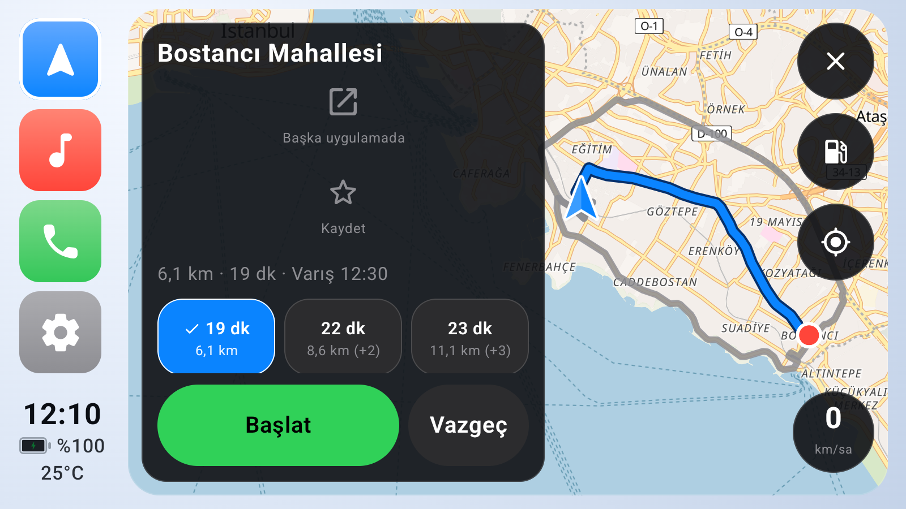

<div align="center">

# RideDeck

**An open-source driving dashboard for your Android phone, built for motorcycles first.**

GPS speed · Voice navigation · Music · Calls · Trip history

**[⬇️ Download signed APK (v0.7.0)](https://github.com/yigitbuyukeren/ridedeck/releases/download/v0.7.0/RideDeck-0.7.0.apk)** &nbsp;·&nbsp;
**[📋 Release notes](https://github.com/yigitbuyukeren/ridedeck/releases/tag/v0.7.0)** &nbsp;·&nbsp;
**[🌐 Website](https://yigitbuyukeren.com/en/ridedeck/)**

[](https://github.com/yigitbuyukeren/ridedeck/releases/tag/v0.7.0)
[](https://github.com/yigitbuyukeren/ridedeck/actions/workflows/ci.yml)
[](LICENSE)


🇬🇧 [English](#en) &nbsp;·&nbsp; 🇹🇷 [Türkçe](#tr) &nbsp;·&nbsp; [🤝 Contribute](CONTRIBUTING.md) &nbsp;·&nbsp; [Good first issues](https://github.com/yigitbuyukeren/ridedeck/contribute)

</div>

> [!IMPORTANT]
> **RideDeck v0.7.0 is a stable release, but the project is not ready for a public 1.0 launch.** Crash detection/SOS is experimental; real-device use, SMS delivery, lock-screen and OEM behavior remain unverified. It is not a substitute for emergency services or safety equipment. [Release readiness](docs/RELEASE_READINESS.md)

<a id="en"></a>

## 🇬🇧 English

RideDeck puts GPS speed, voice-guided navigation, media, calls and trip history on one landscape screen. It runs directly on your Android phone, with no RideDeck account or proprietary backend. Online features use third-party services.

The interface takes inspiration from Apple CarPlay and Android Auto. RideDeck is a standalone Android app, not a CarPlay or Android Auto integration. Today it is designed for motorcycle use; other vehicle types are a possible future direction, not a supported feature.

<a id="v070-screenshots"></a>

### Screenshots

<p align="center">
  <picture>
    <source media="(prefers-color-scheme: dark)" srcset="docs/screenshots/v0.7.0/dashboard-dark.png">
    
  </picture>
</p>

| Route preview | Turn-by-turn navigation | Music |
|:---:|:---:|:---:|
|  |  |  |

<sub>v0.7.0 debug build on an Android emulator, shown in Turkish with simulated GPS and demo media. These captures do not represent real-device or on-road validation.</sub>

### Highlights

- **Dashboard:** GPS speed, trip information, large touch targets and automatic day/night appearance.
- **Navigation:** OpenStreetMap-based map, motorcycle routes, voice guidance, saved destinations, waypoints and fuel stops; **routing requires internet**.
- **App language:** Turkish or English can be selected in Android 13+ app-language settings; the TTS voice and route instructions switch without restarting the app. Unsupported phone languages fall back to English.
- **Media and calls:** Compatible media-session controls, optional message readout, contact/recents/keypad features; Android permissions and the default dialer role govern some functions.
- **Trip history:** Local trip recording and review.
- **Experimental SOS:** An optional impact-and-inactivity countdown followed by attempted SMS alerts to selected contacts. **Not field-tested and not an emergency-service replacement.**
- **Privacy:** Trips and settings remain on the device, but map tiles, destinations, searches, weather and speed-limit requests use public third-party providers. See the [detailed privacy notes](docs/FEATURES-REFERENCE.md#-gizlilik-ve-izinler).

### Download

**[Download signed stable APK — v0.7.0](https://github.com/yigitbuyukeren/ridedeck/releases/download/v0.7.0/RideDeck-0.7.0.apk)** · [Release notes](https://github.com/yigitbuyukeren/ridedeck/releases/tag/v0.7.0) · [All releases](https://github.com/yigitbuyukeren/ridedeck/releases)

Android 8.0+ (API 26). Installed `0.6.x` versions can be updated in place using the same signing key. Upgrading from `0.5.0` may require uninstalling the earlier version, which may erase its app data.

### Release status

The last reported full JVM run passed **848/848 debug and 848/848 release tests**. Instrumentation: **208 passed, one skipped in the combined run, and that skipped test passed separately**. Lint had zero errors, and static 16 KB alignment checks passed. **No real-device field validation yet; public 1.0 remains NO-GO.** Crash/SOS behavior, real SMS/calls, locked-screen/OEM behavior, intercom and thermal/battery use still require field verification.

Previously downloaded map areas are retained, but **new offline downloads are paused** pending provider-compliance checks; offline routing is unavailable. Do not treat SOS as a guarantee of assistance.

[Release readiness](docs/RELEASE_READINESS.md) · [Technical case study](docs/CASE-STUDY.en.md) · [Detailed feature reference (Turkish)](docs/FEATURES-REFERENCE.md)

### Build and contribute

Requires **JDK 17** and **Android SDK 36**; set `sdk.dir` in `local.properties`, then run `./gradlew testDebugUnitTest assembleDebug`.

[Contributing](CONTRIBUTING.md) · [Development](docs/DEVELOPMENT.md) · [Architecture](docs/ARCHITECTURE.md) · [Translations](docs/TRANSLATING.md) · [Support](SUPPORT.md) · [Security](SECURITY.md) · [Code of Conduct](CODE_OF_CONDUCT.md)

**License:** [Apache 2.0](LICENSE). Map data © [OpenStreetMap contributors](https://www.openstreetmap.org/copyright); providers and other notices: [NOTICE](NOTICE).

---

<a id="tr"></a>

## 🇹🇷 Türkçe

RideDeck, **Android telefonlar için açık kaynak, motosiklet odaklı bir sürüş paneli**. Hızı, sesli navigasyonu, medya ve telefon kontrollerini ve yolculuk geçmişini tek yatay arayüzde birleştirir. Hesap açmak veya RideDeck'e ait bir sunucuya bağlanmak gerekmez; çevrimiçi özellikler üçüncü taraf servisleri kullanır.

Arayüz Apple CarPlay ve Android Auto'dan ilham alır. RideDeck, doğrudan Android telefonda çalışan bağımsız bir uygulamadır; CarPlay veya Android Auto entegrasyonu sunmaz. Bugün motosiklet için tasarlanmıştır; başka araç türleri gelecekte değerlendirilebilir, ancak şu anda desteklenmez.

> [!IMPORTANT]
> **RideDeck v0.7.0 kararlı sürümdür; 1.0 için saha doğrulaması henüz tamamlanmadı.** SOS/kaza algılama deneyseldir; gerçek cihaz, SMS, kilit ekranı ve farklı üreticilerdeki davranışlar doğrulanmamıştır. Acil durum hizmetinin veya güvenlik ekipmanının yerine geçmez. [Doğrulama durumu](docs/RELEASE_READINESS.md)

### ✨ Neler sunuyor?

- **🏍️ Gösterge paneli:** GPS hız göstergesi, saat, pil, sıcaklık, büyük dokunma alanları ve gündüz/gece teması.
- **🧭 Motosiklet navigasyonu:** OpenStreetMap tabanlı harita, sesli yönlendirme, kayıtlı yerler, ara durak ve benzinlik arama. Rota hesabı için internet gerekir.
- **🌐 Uygulama dili:** Android 13+ uygulama dili menüsünden Türkçe/İngilizce seçilebilir; TTS sesi ve rota metinleri uygulamayı yeniden başlatmadan yeni dile geçer. Desteklenmeyen cihaz dilleri İngilizceye düşer.
- **🎵 Müzik ve bildirimler:** Uyumlu medya uygulamalarını kontrol etme ve isteğe bağlı mesaj seslendirme.
- **📞 Telefon:** Rehber, son aramalar ve arama kontrolleri; bazı yetenekler Android izinlerine ve varsayılan telefon uygulaması rolüne bağlıdır.
- **📍 Yolculuk geçmişi:** Konumla kaydedilen yolculukları görüntüleme; kayıtlar cihazda tutulur.
- **🆘 İsteğe bağlı SOS:** Algılanan sert darbe ve hareketsizlik sonrası geri sayım ve seçilen kişilere SMS gönderim denemesi. **Saha testi yapılmamış deneysel özelliktir; mesaj teslimi garanti edilmez.**

[Daha ayrıntılı özellikler, sınırlamalar ve gizlilik notları](docs/FEATURES-REFERENCE.md)

### 📸 Uygulama ekranları

[v0.7.0 ekran görüntüleri](#v070-screenshots): Ana panel, rota önizlemesi, aktif navigasyon ve müzik. Görseller, Android emülatöründe debug derlemesinden, simüle edilmiş konum ve demo müzikle alınmıştır; gerçek cihaz veya sürüş doğrulaması değildir.

### 📲 İndir ve kur

**[Resmî imzalı kararlı APK: v0.7.0](https://github.com/yigitbuyukeren/ridedeck/releases/download/v0.7.0/RideDeck-0.7.0.apk)** · [Tüm sürümler](https://github.com/yigitbuyukeren/ridedeck/releases) · [Web sitesi](https://yigitbuyukeren.com/ridedeck/)

Android **8.0 (API 26)** ve üzerini destekler. APK'yı yalnız resmî sürüm bağlantısından indir. `0.6.x` üzerinden aynı imza anahtarıyla güncellenebilir; `0.5.0` farklı anahtar kullandığından kaldırma gerekebilir ve bu işlem uygulama verilerini silebilir. İzinler, kullanılan özelliğe göre istenir.

### ✅ Güncel doğrulama ve sınırlar

| Kontrol | Son raporlanan sonuç |
|---|---|
| Kararlı sürüm | `0.7.0` · `versionCode 8` · imzalı APK |
| JVM birim testleri | **848/848 debug + 848/848 release** (1.696 toplam) |
| Android instrumentation | **208 geçti + 1 atlandı**; atlanan izin testi ayrı koşuda geçti (209 doğrulandı) |
| Lint ve hizalama | **0 lint hatası**; 16 KB statik hizalama kontrolü geçti |
| Gerçek cihaz / saha | **Doğrulanmadı — genel 1.0 kararı NO-GO** |

**Önemli sınırlar:** Navigasyon, adres arama ve hava durumu çevrimiçi çalışır. Önceden indirilmiş harita alanları korunur, ancak sağlayıcı koşulları doğrulanana kadar yeni çevrimdışı bölge indirmeleri kapalıdır; çevrimdışı rota hesabı yoktur. SOS, kilit ekranı, gerçek SIM/SMS, interkom, Doze ve pil/ısı davranışı saha doğrulaması gerektirir. Sürüş sırasında ayar yapma veya ekrana dikkat gerektiren işlemlerden kaçın.

[Güncel yayın hazırlığı](docs/RELEASE_READINESS.md) · [Denetim geçmişi](docs/STATUS.md) · [Gizlilik ve servis ayrıntıları](docs/FEATURES-REFERENCE.md#-gizlilik-ve-izinler)

### 🛠️ Geliştirme ve katkı

**Kotlin · Jetpack Compose · MapLibre · OpenStreetMap · Valhalla · Android SDK 36 · JDK 17**

```bash
# Android SDK 36 ve JDK 17 hazır olmalı; local.properties içinde sdk.dir ayarla
./gradlew testDebugUnitTest assembleDebug
```

| Başlamak için | Ayrıntı için |
|---|---|
| [Katkı rehberi](CONTRIBUTING.md) | [Geliştirme ortamı ve testler](docs/DEVELOPMENT.md) |
| [Hata bildir](https://github.com/yigitbuyukeren/ridedeck/issues/new?template=bug_report.yml) | [Mimari](docs/ARCHITECTURE.md) |
| [Çeviri katkısı](docs/TRANSLATING.md) | [Teknik vaka analizi](docs/CASE-STUDY.md) |
| [Destek](SUPPORT.md) | [Güvenlik bildirimi](SECURITY.md) · [Davranış kuralları](CODE_OF_CONDUCT.md) |

Güvenlikle ilgili açıkları herkese açık issue yerine [SECURITY.md](SECURITY.md) üzerinden bildir. Harita ve üçüncü taraf lisans/atıf bilgileri [NOTICE](NOTICE) içinde yer alır.

---
