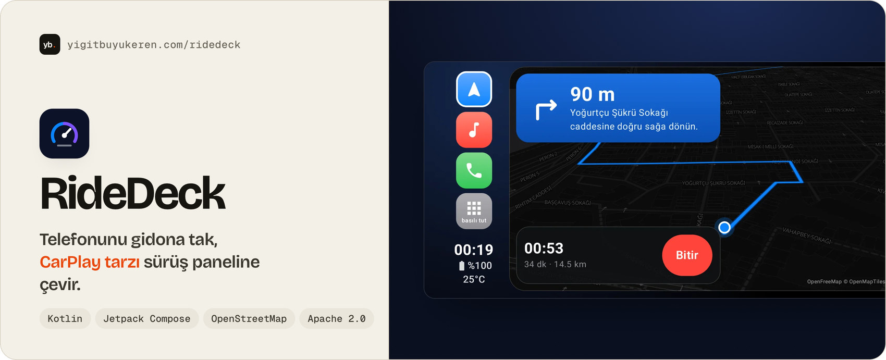
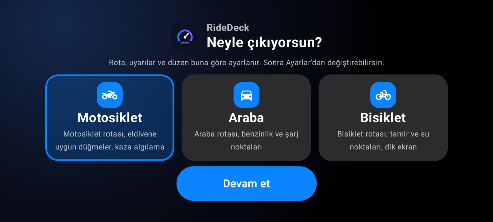
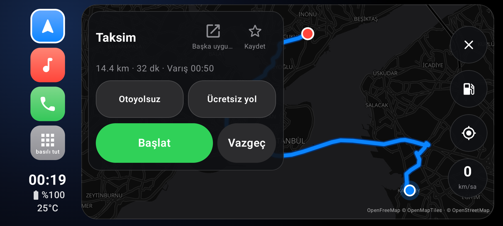
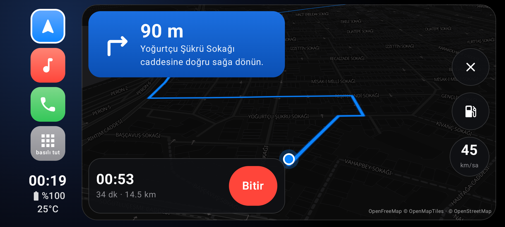
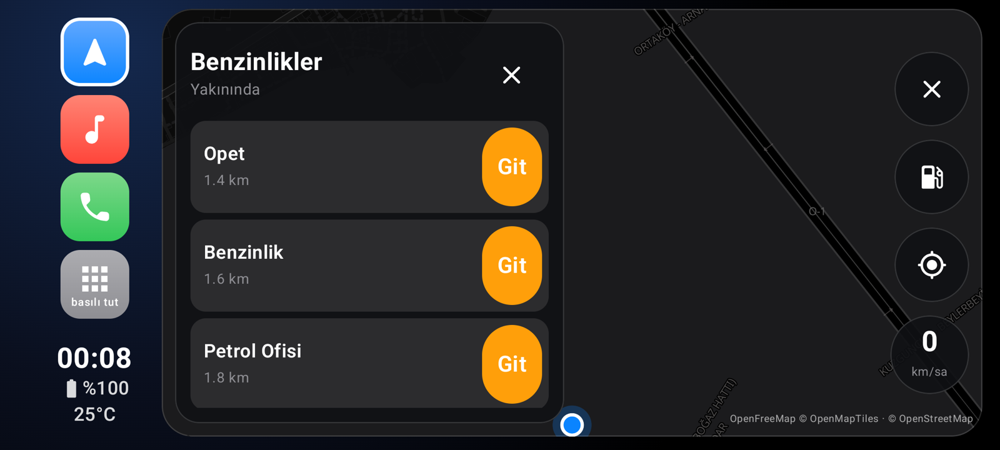
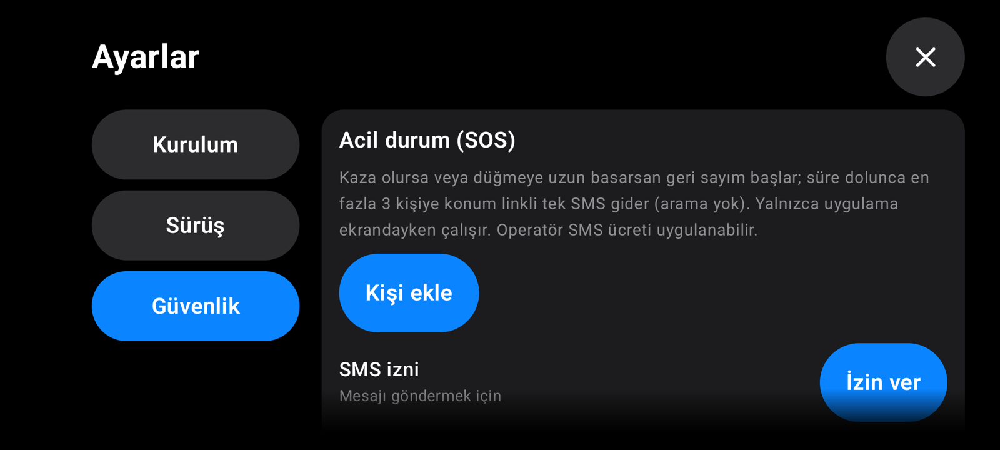
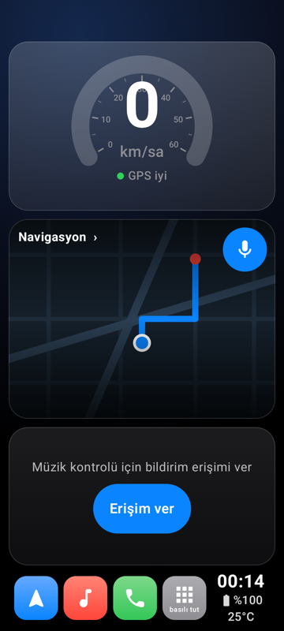

<a href="https://yigitbuyukeren.com/ridedeck/">
  <picture>
    <source media="(prefers-color-scheme: dark)" srcset="docs/screenshots/banner-dark.jpg">
    
  </picture>
</a>

<div align="center">

**[⬇️ APK indir](https://github.com/yigitbuyukeren/ridedeck/releases/latest)** &nbsp;·&nbsp; **[🌐 Proje sayfası](https://yigitbuyukeren.com/ridedeck/)** &nbsp;·&nbsp; **[📖 Teknik vaka analizi](docs/CASE-STUDY.md)** &nbsp;·&nbsp; **[🧭 Özellikler](#-özellikler)** &nbsp;·&nbsp; **[🛠️ Derleme](#️-derleme)** &nbsp;·&nbsp; **[🤝 Katkı](CONTRIBUTING.md)**

[](https://github.com/yigitbuyukeren/ridedeck/releases/latest)
[](https://github.com/yigitbuyukeren/ridedeck/actions/workflows/ci.yml)
[](LICENSE)


🇹🇷 [Türkçe](#-türkçe) &nbsp;·&nbsp; 🇬🇧 [English](#-english)

</div>

<p align="center"><br><sub>Emülatörde, sahte GPS ile alınmış ekran görüntülerinin geçişi; ekran kaydı veya gerçek cihaz testi değildir.</sub></p>

<details open>
<summary><h2>🇹🇷 Türkçe</h2></summary>

Telefonu gidona veya torpido üstüne takınca **hız, harita, müzik ve telefon tek ekranda** toplanır. İlk açılışta aracını seçersin (Ayarlar'dan değişir); rota, uyarılar ve düzen ona göre ayarlanır. Tüm arayüz eldivenle kullanılacak büyüklükte, sürerken yazı girişi yoktur.

### ✨ Öne çıkanlar

| 🧭 **Sesli navigasyon** | 🎙️ **Türkçe sesli asistan** | 🆘 **SOS ve kaza algılama** |
|:---:|:---:|:---:|
| OpenStreetMap haritası, motosiklet / araba / bisiklet rotası, ara durak, benzinlik ve şarj | "Eve git", "Ali'yi ara", "son mesajı oku"; kask mikrofonu desteği | Sert darbe ve hareketsizlikte geri sayım, sonra konum linkli tek SMS |
| 🎵 **Müzik ve telefon** | 🌦️ **Uyarılar** | 🔒 **Gizlilik** |
| Kapak kaydırma, uygulama içi rehber, tuş takımı ve arama ekranı | Yağmur, buzlanma ve rüzgâr uyarısı; telefon ısınınca ekran kısılır | Veriler telefonda kalır; yalnızca harita/yer sorguları çıkar, konuşma tanıma Android servisleriyle yapılır |

### 📸 Ekran görüntüleri

Aşağıdakiler Android emülatöründen (Türkçe arayüz) alınmıştır.

| İlk açılışta araç seçimi | Rota |
|---|---|
|  |  |

| Navigasyon | Benzinlikler |
|---|---|
|  |  |

| SOS geri sayımı | Güvenlik ayarları |
|---|---|
|  |  |

Bisiklet profilinde telefon dik de durabilir:



### 📲 Kurulum

1. [Son sürümün](https://github.com/yigitbuyukeren/ridedeck/releases/latest) APK'sını indir ve kur (bilinmeyen kaynaklardan kuruluma izin ver).
2. İlk açılışta aracını seç; istersen RideDeck'i ana ekran (HOME) uygulaması yap.
3. Müzik ve mesaj okuma için Ayarlar > Kurulum'dan bildirim erişimini ver.

### 🧭 Özellikler

Ayrıntılar için başlıklara dokun.

<details>
<summary><b>Araç profilleri</b></summary>

- İlk açılışta Motosiklet / Araba / Bisiklet seçimi; Ayarlar > Kurulum'dan değişir, kendi ayarların korunur
- Rota araca göre: Valhalla `motorcycle`, `auto` veya `bicycle`; bisiklette yokuşsuz, düz zemin ve bisiklet tipi (yol / şehir / dağ)
- ⛽ düğmesi: motosiklette benzinlik, arabada benzinlik ve şarj istasyonu, bisiklette tamir noktası, bisiklet dükkânı ve içme suyu
- Kaza algılama eşikleri ve hız göstergesi ölçeği araca göre; bisiklette rüzgâr uyarısı ve dik ekran desteği (ana ekran, müzik, telefon, ayarlar dikey de çalışır)

</details>

<details>
<summary><b>Gösterge ve sürüş</b></summary>

- GPS hız göstergesi, saat, pil ve telefon sıcaklığı; gündüz/gece teması (ortam ışığına göre otomatik). Gösterilen hız GPS gürültüsünü yumuşatır ve imkânsız sıçramaları bir kez tutar; sinyal kesilince son değer kısa süre kalır, sonra uydurma 0 yerine `--` ve "GPS sinyali kayıp" görünür. Kaza algılama, yolculuk kaydı ve limit uyarısı ham GPS hızını kullanır
- Yolculuk kaydı: otomatik, geçmiş ekranı
- Hız kartında GPS durumu; büyük, eldivenle basılan tuşlar; ekranlar arasında kısa geçiş animasyonları (ısı koruması açıkken kapanır)
- Türkçe ve İngilizce arayüz

</details>

<details>
<summary><b>Navigasyon</b></summary>

- Gömülü harita ve sesli yönlendirme: MapLibre + OpenStreetMap (OpenFreeMap), Nominatim arama, Valhalla araç rotası, rota dışına çıkınca yeniden hesaplama
- Rota seçenekleri: otoyolsuz ve ücretsiz yol (bisiklette yokuşsuz ve düz zemin), seçim hatırlanır
- Kayıtlı yerler: Ev, İş ve favoriler; büyük karolarla tek dokunuşla rota, dashboard'da "Eve git"
- Park yeri: yolculuk bittiğinde aracın bırakıldığı yer otomatik kaydedilir ("Park yerine git"); eski bir gün ise tarihiyle görünür
- Duraklar (benzinlik, şarj, tamirci, su): yakınında veya rotanın üzerinde; navigasyon sırasında tek dokunuşla **ara durak** ekle, varınca "Yola devam"
- Yolun hız limiti ve aşınca sesli uyarı
- Sürerken arama kutusu ve Ayarlar kilitlenir (sürüş kuralı: hareket halindeyken yazı girişi ve ayar değişikliği yok); hedefi kayıtlı yerlerden veya haritaya uzun basarak seç
- Yazım hatası toleransı: sonuç çıkmazsa düzeltilmiş yazımlar (Türkçe harfler, eksik veya yer değiştirmiş harf) en çok üç kez, saniyede en fazla bir istekle denenir; yine bulunamazsa "Bunu mu demek istedin?" önerisi gelir. Önerilen yer sormadan rotaya girmez; sesli komutta da evet/hayır sorulur. Seçtiğin son hedefler yalnızca telefonda tutulur (Ayarlar > Sürüş'ten kapatılır, "Geçmişi sil" ile silinir)
- Navigasyon sürerken ana ekranda canlı mini harita, sıradaki dönüş, kalan mesafe ve varış saati
- Arama kutusu için uygulamanın kendi Türkçe klavyesi

</details>

<details>
<summary><b>Uygulamalar, kartlar ve ses</b></summary>

- Uygulama rafı (dock'taki son karo): mesajlaşma, video veya istediğin uygulamayı sabitle, büyük karolarla tek dokunuşla başlat; ekleme ve sıralama sürerken kilitli; Ayarlar rafın sağ üstündeki dişli düğmesinden açılır
- Ana ekran kartları ayarlanır (Ayarlar > Sürüş): harita, müzik, uygulama kartı (sabitlediğin uygulamalar tek sırada) veya boş
- Rota kartında "Navigasyon uygulamasında aç" (Google Haritalar, Waze, Yandex Navi derin bağlantıları, yalnızca dururken); rota hâlâ RideDeck'te hesaplanır, canlı trafik isteyen bu uygulamalara geçer
- Sesle komut (Türkçe, yaklaşık 130 kalıp): mikrofon düğmesi (navigasyon kartı, harita arama kutusu), Bluetooth kaskın sesli komut düğmesi veya sistem "asistan" hareketi dinlemeyi başlatır; bip ve titreşim başlangıcı ve bitişi bildirir. Hedefe git, eve/işe/park yerine git, en yakın benzinlik/kafe/eczane/hastane/ATM, kalan süre ve varış saati, sıradaki dönüş, otoyolsuz/ücretsiz yol, burayı kaydet; "Ali'yi ara" (birden çok Ali varsa "hangisi?" diye sorar, 3 sn geri sayım), son arananı/cevapsızı ara, gelen aramada cevapla/reddet/sessize al/hoparlör; son mesajı oku, "cevap yaz" (ne yazacağını sorar, göndermeden önce sesli onay ister); müzik, ada göre çalma, ses seviyesi yüzdesi; hava, saat, pil, hız, hız sınırı; uygulama aç, gece/gündüz, mil/km. Aynı cümlede en çok dört komut art arda verilebilir. "Ne diyebilirim?" ekranı tüm komutları listeler. Komutlar Android'in konuşma tanıyıcısıyla tanınır; çevrimdışı Türkçe paketi telefona göre indirilebilir, ses tanıma hizmetinin veri politikası cihaza bağlıdır. Sesli yanıt ve kask mikrofonu Ayarlar > Sürüş'ten kapatılır. Sürekli "Hey RideDeck" uyandırması şu an kullanılamıyor; manuel mikrofon ve kask tuşuyla başlatma kullanılabilir.
- Sesli asistan ayarları (Ayarlar > Sürüş): Android tanıyıcısı, sesli yanıt, kask mikrofonu, komut geçmişi (son 10 komutun metni), kask tuşuna çift basış ve isteğe bağlı "Hey RideDeck" çevrimdışı uyandırması. Uyandırma, sherpa-onnx KWS ve uygulamayla gelen yerel modelle yalnızca ekran açıkken çalışır; algılamadan sonra mevcut Android konuşma tanıyıcısı komut için devralır. Ayarlar > Kurulum'dan RideDeck varsayılan dijital asistan seçilebilir (kaskın sesli komut düğmesi için) ve çevrimdışı Türkçe tanıma paketi indirilebilir. Komutlara ayrıca başka rota, yolda kafe/eczane gibi ara durak, yolculuk özeti, ekran parlaklığı ve sesli hava uyarısını kapatma eklendi; belirsiz duyulan komut "şunu mu dedin?" diye sorulur
- Mil ve mph ayarı (Ayarlar > Sürüş): hız, mesafe, hız limiti ve rota sesleri
- Mesaj uygulamalarını tek tek sessize alma (Ayarlar'da görülen uygulamalar için anahtar)

</details>

<details>
<summary><b>Güvenlik</b></summary>

- Hava durumu: sıcaklık, 1 saat içinde yağmur ve buzlanma uyarısı, bisiklette sert rüzgâr (şerit + sesli)
- Isınma koruması: telefon 42°C'yi aşınca ekran kısılır ve harita yavaşlar, araç durunca ekran kararır
- SOS (varsayılan kapalı): otomatik kaza algılama (sert darbe + hareketsizlik; iki tekerlekte telefonun yönü de değişmiş olmalı, çukur ve kırmızı ışık alarm vermez) veya uzun basmalı düğme; geri sayımdan sonra en fazla 3 kişiye konum linkli **tek** SMS, arama yok

</details>

<details>
<summary><b>Telefon ve medya</b></summary>

- Uygulama içi telefon: son aramalar, tüm rehber ve tuş takımı (eşleşen kişi önerisi, büyük silme tuşu, `0` uzun basınca `+`; yatay telefonda listede 4 satır görünür); sürerken tuş takımı kilitli
- RideDeck'i varsayılan telefon uygulaması yaparsan arama ekranı da uygulamanın içinde: sessiz, ses yolu (telefon, hoparlör, Bluetooth), ses seviyesi, görüşme tuş takımı
- Müzik: yalnızca müzik uygulamalarının oturumu, ilerleme çubuğu, kapağı kaydırarak şarkı geçme, ses tuşları; hiçbir şey çalmıyorken Oynat son müziği başlatır (bildirim erişimi gerekir)
- Mesajları sesli okuma (yalnızca RideDeck ekrandayken)
- Diğer uygulamaların üstünde hız/saat şeridi; ana ekran (HOME) launcher olarak ayarlanabilir

</details>

### 🚧 Bilinen sınırlamalar

- **Sahada doğrulanmayanlar:** kaza algılama eşikleri (gerçek düşüşte denenmedi), gerçek SMS gönderimi, kask Bluetooth mikrofonu, gürültüde Türkçe tanıma kalitesi, varsayılan telefon uygulamasıyken arama ses yolu, gidonda ısınma ve mini harita pil etkisi, Android 8–10 davranışı. Güncel liste: [docs/STATUS.md](docs/STATUS.md).
- Navigasyon ve hava durumu **internet gerektirir** (çevrimdışı harita/rota yok); genel servisler garantisizdir.
- Sürekli "Hey RideDeck" dinlemesi yok; mikrofon düğmesi veya kask tuşu kullanılır. Sesli komutlar yalnızca Türkçe.
- Canlı trafik, radar uyarısı, iOS ve Android Auto desteği yok.
- SOS/kaza algılama yardımcı bir özelliktir, güvenlik garantisi değildir; yalnızca uygulama ekrandayken çalışır.

📖 Tasarım kararları ve testler: [Teknik vaka analizi](docs/CASE-STUDY.md) · [English](docs/CASE-STUDY.en.md)

### 🛠️ Derleme

```bash
export JAVA_HOME=/opt/homebrew/opt/openjdk@17
./gradlew testDebugUnitTest assembleDebug
adb install -r app/build/outputs/apk/debug/app-debug.apk
```
`local.properties` içinde `sdk.dir` ayarlı olmalı (dosya git'e girmez).

Sürüm APK'sı (R8 ile küçültülmüş, ~24 MB): kök dizine `keystore.properties` koy (`storeFile`, `storePassword`, `keyAlias`, `keyPassword`; dosya git'e girmez) ve `./gradlew assembleRelease` çalıştır. Dosya yoksa APK imzasız çıkar.

### 🔒 Gizlilik ve izinler

Hesap ve sunucu yok; veriler telefonda kalır. Dışarı giden tek şey, aşağıdaki genel servislere giden sorgulardır: arama metni (Nominatim, yalnızca Ara'ya basınca), rota uç noktaları ve hız limiti için son konum noktaları (Valhalla), yaklaşık konum (hava durumu için 1 km hassasiyetle, Open-Meteo), çevre veya rota boyunca benzinlik sorgusu (Nominatim / Overpass).

SOS yalnızca sen açarsan çalışır ve `SEND_SMS` izni ister; kişiler telefonun kişi seçicisinden eklenir (rehber izni gerekmez). Sesle komut için mikrofon izni ilk kullanımda ekrandaki düğmeyle istenir; ses tanıma Android'in kendi tanıyıcısıyla yapılır. Kaza algılama yalnızca uygulama ekrandayken çalışır; Android arka plandaki sensörleri kısıtlar. Operatörün SMS ücreti uygulanabilir. Bu özellik bir güvenlik garantisi değildir.

### ⚠️ Güvenlik notu

> [!WARNING]
> Bu uygulama sürüş sırasında dikkat dağıtabilir. Telefonu sabitle, ayarları park halindeyken yap ve trafik kurallarına uy. Yazılım garantisiz sunulur (Apache 2.0).

### 🗺️ Kullanılan servisler ve atıflar

- Harita verisi © [OpenStreetMap](https://www.openstreetmap.org/copyright) katkıda bulunanlar (ODbL)
- Harita karoları: [OpenFreeMap](https://openfreemap.org); harita motoru: [MapLibre Native](https://maplibre.org)
- Adres arama: [Nominatim](https://nominatim.org) (genel sunucu; kullanım politikasına uygun olarak yalnızca Ara'ya basınca sorgular)
- Rota: [Valhalla](https://github.com/valhalla/valhalla) genel sunucusu (`valhalla1.openstreetmap.de`)
- Hava durumu: [Open-Meteo](https://open-meteo.com) (ücretsiz, anahtarsız; ticari olmayan kullanım)
- Benzinlikler: [Overpass API](https://overpass-api.de) genel sunucuları (birkaçına birden sorulur) ve Nominatim

Bunlar ücretsiz, garantisiz genel servislerdir. Yoğun veya ticari kullanım için kendi sunucunu kur.

### 🤝 Katkı

Issue ve PR'lar açık. Başlamak için [CONTRIBUTING.md](CONTRIBUTING.md) dosyasına ve [docs/STATUS.md](docs/STATUS.md) içindeki "Sıradaki işler" listesine bak. Fikirler: yeni dil çevirileri, çevrimdışı harita ve rota (büyük iş), tablet ve katlanabilir ekran düzenleri.

### 📜 Lisans

[Apache 2.0](LICENSE)

⭐ İşine yaradıysa yıldız vermeyi unutma!

</details>

<details>
<summary><h2>🇬🇧 English</h2></summary>

| 🧭 **Voice navigation** | 🎙️ **Turkish voice assistant** | 🆘 **SOS and crash detection** |
|:---:|:---:|:---:|
| OpenStreetMap, motorcycle / car / bicycle routing, waypoints, fuel and charging stops | "Go home", "Call Ali", "read the last message"; helmet mic support | Countdown after a hard impact and no movement, then a single SMS with your location |
| 🎵 **Music and phone** | 🌦️ **Alerts** | 🔒 **Privacy** |
| Cover swipe, in-app contacts, dial pad and call screen | Rain, ice and wind alerts; the screen dims when the phone overheats | Data stays on the phone; public map queries leave it, and speech uses Android's recognition service |

RideDeck is a free, open-source Android app (Kotlin, Jetpack Compose, minSdk 26) that turns a phone into a CarPlay-style landscape dashboard for motorcycles, cars and bicycles: GPS speedometer, voice-guided OpenStreetMap navigation, fuel/charging/repair stops, weather alerts, music, an in-app phone, a Turkish voice assistant and crash-detecting SOS. No accounts, API keys or RideDeck backend; navigation queries use free public map services and speech uses Android's recognizer. The UI has Turkish and English; voice commands are Turkish only. Build with `./gradlew assembleDebug` (JDK 17). Contributions are welcome, see [CONTRIBUTING.md](CONTRIBUTING.md). Technical write-up: [case study](docs/CASE-STUDY.en.md). Known limits: crash-detection thresholds, real SMS sending and the helmet microphone are not field-tested; screenshots and the demo GIF come from an emulator with simulated GPS; navigation needs a network connection; SOS is an aid, not a safety guarantee.
Voice commands use Android's speech recognition service. Offline recognition depends on the Turkish speech pack supported by the device. Optional “Hey RideDeck” wake detection uses the bundled sherpa-onnx KWS model locally while RideDeck is in the foreground; the existing Android recognizer takes over after a match.

</details>
