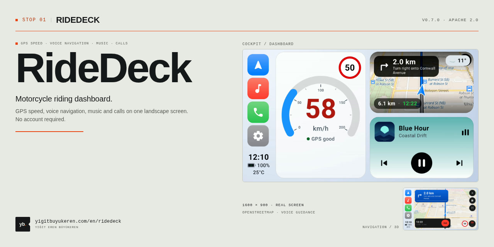
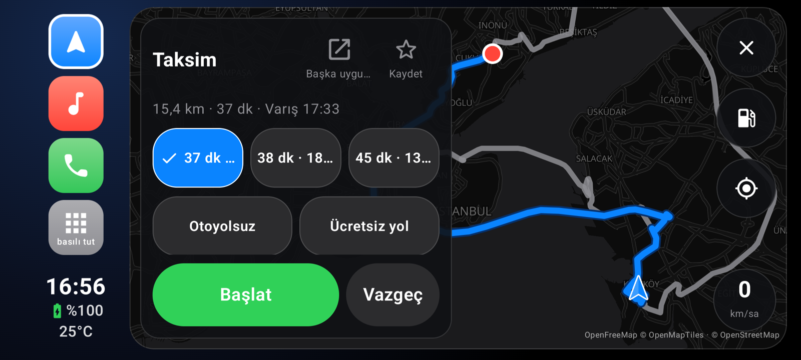
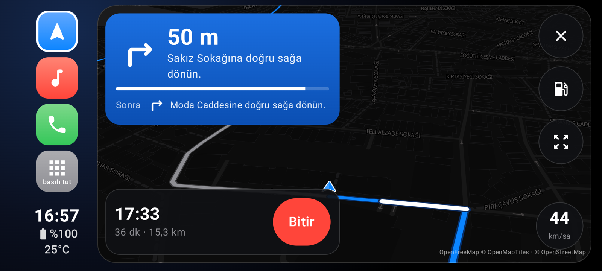
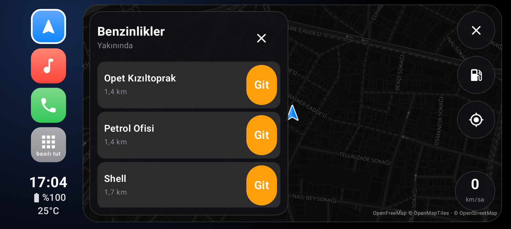

<a href="https://yigitbuyukeren.com/ridedeck/">
  <picture>
    <source media="(prefers-color-scheme: dark)" srcset="docs/screenshots/banner-dark.jpg">
    
  </picture>
</a>

### RideDeck
**Telefonun için açık kaynak motosiklet kokpiti** · **Open-source motorcycle dashboard for Android**

GPS hızı · Sesli navigasyon · Müzik · Telefon · Yolculuk geçmişi

**[⬇️ Beta APK indir (0.6.1-beta.1)](https://github.com/yigitbuyukeren/ridedeck/releases/download/v0.6.1-beta.1/RideDeck-0.6.1-beta.1.apk)** &nbsp;·&nbsp;
**[📋 Sürüm notları](https://github.com/yigitbuyukeren/ridedeck/releases/tag/v0.6.1-beta.1)** &nbsp;·&nbsp;
**[🌐 Web sitesi](https://yigitbuyukeren.com/ridedeck/)**

🇹🇷 [Türkçe](#tr) &nbsp;·&nbsp; 🇬🇧 [English](#en) &nbsp;·&nbsp; [🤝 Katkıda bulun](CONTRIBUTING.md)

> [!IMPORTANT]
> **Bu bir beta sürümdür; RideDeck 1.0 henüz yayına hazır değildir.** SOS/kaza algılama deneyseldir; gerçek cihaz, gerçek SMS, kilit ekranı ve farklı üreticilerdeki davranışlar doğrulanmamıştır. Acil durum hizmetinin veya güvenlik ekipmanının yerine geçmez. [Doğrulama durumu](docs/RELEASE_READINESS.md)

## 🇹🇷 Türkçe

RideDeck, **Android telefonlar için motosiklet odaklı bir yatay gösterge paneli**. Hız, rota, medya ve telefon kontrollerini tek arayüzde birleştirir. Hesap açmak veya RideDeck'e ait bir sunucuya bağlanmak gerekmez; çevrimiçi özellikler ise üçüncü taraf harita ve hava durumu servislerine istek gönderir.

### ✨ Neler sunuyor?

- **🏍️ Gösterge paneli:** GPS hız göstergesi, saat, pil, sıcaklık, büyük dokunma alanları ve gündüz/gece teması.
- **🧭 Motosiklet navigasyonu:** OpenStreetMap tabanlı harita, sesli yönlendirme, kayıtlı yerler, ara durak ve benzinlik arama. Rota hesabı için internet gerekir.
- **🎵 Müzik ve bildirimler:** Uyumlu medya uygulamalarını kontrol etme ve isteğe bağlı mesaj seslendirme.
- **📞 Telefon:** Rehber, son aramalar ve arama kontrolleri; bazı yetenekler Android izinlerine ve varsayılan telefon uygulaması rolüne bağlıdır.
- **📍 Yolculuk geçmişi:** Konumla kaydedilen yolculukları görüntüleme; kayıtlar cihazda tutulur.
- **🆘 İsteğe bağlı SOS:** Algılanan sert darbe ve hareketsizlik sonrası geri sayım ve seçilen kişilere SMS gönderim denemesi. **Saha testi yapılmamış deneysel özelliktir; mesaj teslimi garanti edilmez.**

[Daha ayrıntılı özellikler, sınırlamalar ve gizlilik notları](docs/FEATURES-REFERENCE.md)

### 📸 Uygulama ekranları

| Navigasyon | Benzinlikler |
|:---:|:---:|
|  |  |

Görseller Android emülatöründe, simüle edilmiş konumla alınmıştır; gerçek sürüş veya gerçek cihaz doğrulaması değildir. Bazı ayrıntılar mevcut betadan farklı olabilir. Eski araç seçimini gösteren demo GIF'i ana vitrinden çıkarıldı.

### 📲 İndir ve kur

**[Resmî imzalı beta APK: v0.6.1-beta.1](https://github.com/yigitbuyukeren/ridedeck/releases/download/v0.6.1-beta.1/RideDeck-0.6.1-beta.1.apk)** · [Tüm sürümler](https://github.com/yigitbuyukeren/ridedeck/releases)

Android **8.0 (API 26)** ve üzerini destekler. APK'yı yalnız resmî sürüm bağlantısından indir. \`0.6.0\` üzerinden aynı imza anahtarıyla güncellenebilir; \`0.5.0\` farklı anahtar kullandığından kaldırma gerekebilir ve bu işlem uygulama verilerini silebilir. İzinler, kullanılan özelliğe göre istenir.

### ✅ Güncel doğrulama ve sınırlar

| Kontrol | Son raporlanan sonuç |
|---|---|
| Beta | \`0.6.1-beta.1\` · \`versionCode 7\` · imzalı APK |
| JVM birim testleri | **831/831 debug + 831/831 release** (1.662 toplam) |
| Android instrumentation | **203 geçti + 1 atlandı**; atlanan izin testi ayrı koşuda geçti (204 doğrulandı) |
| Lint ve hizalama | **0 lint hatası**; 16 KB statik hizalama kontrolü geçti |
| Gerçek cihaz / saha | **Doğrulanmadı — genel 1.0 kararı NO-GO** |

**Önemli sınırlar:** Navigasyon, adres arama ve hava durumu çevrimiçi çalışır. Önceden indirilmiş harita alanları korunur, ancak sağlayıcı koşulları doğrulanana kadar yeni çevrimdışı bölge indirmeleri kapalıdır; çevrimdışı rota hesabı yoktur. SOS, kilit ekranı, gerçek SIM/SMS, interkom, Doze ve pil/ısı davranışı saha doğrulaması gerektirir. Sürüş sırasında ayar yapma veya ekrana dikkat gerektiren işlemlerden kaçın.

[Güncel yayın hazırlığı](docs/RELEASE_READINESS.md) · [Denetim geçmişi](docs/STATUS.md) · [Gizlilik ve servis ayrıntıları](docs/FEATURES-REFERENCE.md#-gizlilik-ve-izinler)

### 🛠️ Geliştirme ve katkı

**Kotlin · Jetpack Compose · MapLibre · OpenStreetMap · Valhalla · Android SDK 36 · JDK 17**

\`\`\`bash
# Android SDK 36 ve JDK 17 hazır olmalı; local.properties içinde sdk.dir ayarla
./gradlew testDebugUnitTest assembleDebug
\`\`\`

| Başlamak için | Ayrıntı için |
|---|---|
| [Katkı rehberi](CONTRIBUTING.md) | [Geliştirme ortamı ve testler](docs/DEVELOPMENT.md) |
| [Hata bildir](https://github.com/yigitbuyukeren/ridedeck/issues/new?template=bug_report.yml) | [Mimari](docs/ARCHITECTURE.md) |
| [Çeviri katkısı](docs/TRANSLATING.md) | [Teknik vaka analizi](docs/CASE-STUDY.md) |
| [Destek](SUPPORT.md) | [Güvenlik bildirimi](SECURITY.md) · [Davranış kuralları](CODE_OF_CONDUCT.md) |

Güvenlikle ilgili açıkları herkese açık issue yerine [SECURITY.md](SECURITY.md) üzerinden bildir. Harita ve üçüncü taraf lisans/atıf bilgileri [NOTICE](NOTICE) içinde yer alır.

---

## 🇬🇧 English

**RideDeck** is a free, open-source, motorcycle-focused Android dashboard. It combines GPS speed, voice-guided navigation, music, phone controls and trip history in a landscape interface. No RideDeck account or proprietary backend is required, although online features contact third-party services.

### Highlights

- **Dashboard:** GPS speed, trip information, large touch targets and automatic day/night appearance.
- **Navigation:** OpenStreetMap-based map, motorcycle routes, voice guidance, saved destinations, waypoints and fuel stops; **routing requires internet**.
- **Media and calls:** Compatible media-session controls, optional message readout, contact/recents/keypad features; Android permissions and the default dialer role govern some functions.
- **Trip history:** Local trip recording and review.
- **Experimental SOS:** An optional impact-and-inactivity countdown followed by attempted SMS alerts to selected contacts. **Not field-tested and not an emergency-service replacement.**
- **Privacy:** Trips and settings remain on the device, but map tiles, destinations, searches, weather and speed-limit requests use public third-party providers. See the [detailed privacy notes](docs/FEATURES-REFERENCE.md#-gizlilik-ve-izinler).

### Download

**[Download signed beta APK — v0.6.1-beta.1](https://github.com/yigitbuyukeren/ridedeck/releases/download/v0.6.1-beta.1/RideDeck-0.6.1-beta.1.apk)** · [Release notes](https://github.com/yigitbuyukeren/ridedeck/releases/tag/v0.6.1-beta.1) · [All releases](https://github.com/yigitbuyukeren/ridedeck/releases)

Android 8.0+ (API 26). An installed \`0.6.0\` can be updated in place using the same signing key. Upgrading from \`0.5.0\` may require uninstalling the earlier version, which may erase its app data.

### Beta status

The last reported full JVM run passed **831/831 debug and 831/831 release tests**. Instrumentation: **203 passed, one skipped in the combined run, and that skipped test passed separately**. Lint had zero errors, and static 16 KB alignment checks passed. **No real-device field validation yet; public 1.0 remains NO-GO.** Crash/SOS behavior, real SMS/calls, locked-screen/OEM behavior, intercom and thermal/battery use still require field verification.

Previously downloaded map areas are retained, but **new offline downloads are paused** pending provider-compliance checks; offline routing is unavailable. Do not treat SOS as a guarantee of assistance.

[Release readiness](docs/RELEASE_READINESS.md) · [Technical case study](docs/CASE-STUDY.en.md) · [Detailed feature reference (Turkish)](docs/FEATURES-REFERENCE.md)

### Build and contribute

Requires **JDK 17** and **Android SDK 36**; set \`sdk.dir\` in \`local.properties\`, then run \`./gradlew testDebugUnitTest assembleDebug\`.

[Contributing](CONTRIBUTING.md) · [Development](docs/DEVELOPMENT.md) · [Architecture](docs/ARCHITECTURE.md) · [Translations](docs/TRANSLATING.md) · [Support](SUPPORT.md) · [Security](SECURITY.md) · [Code of Conduct](CODE_OF_CONDUCT.md)

**License:** [Apache 2.0](LICENSE). Map data © [OpenStreetMap contributors](https://www.openstreetmap.org/copyright); providers and other notices: [NOTICE](NOTICE).
